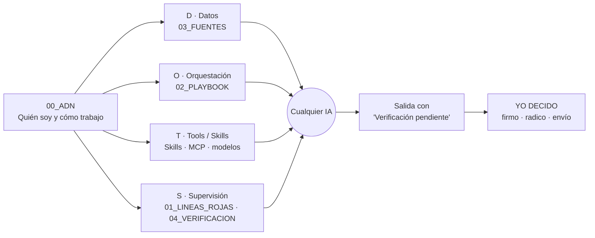
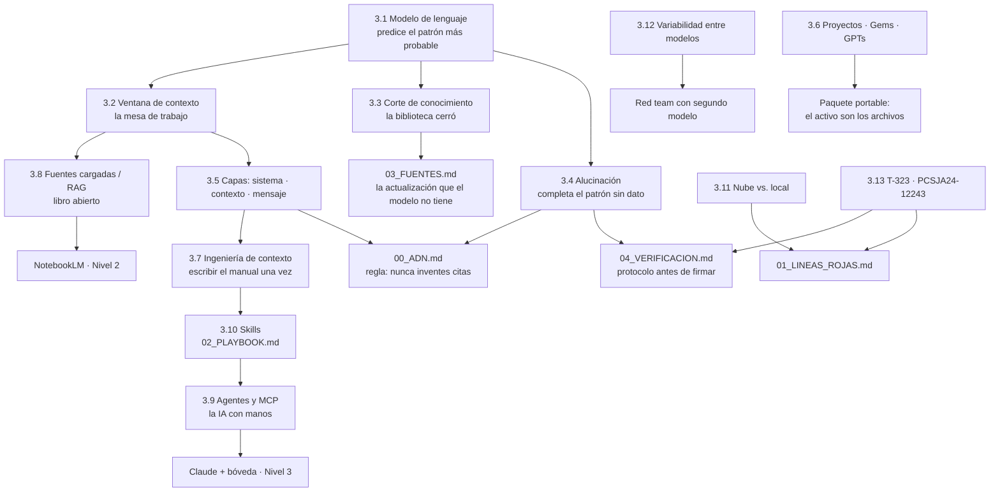
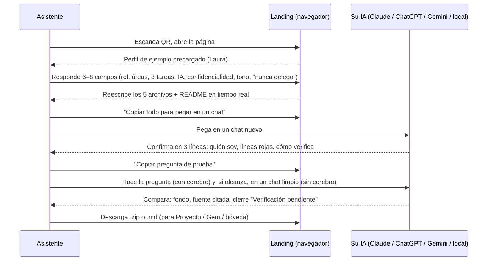
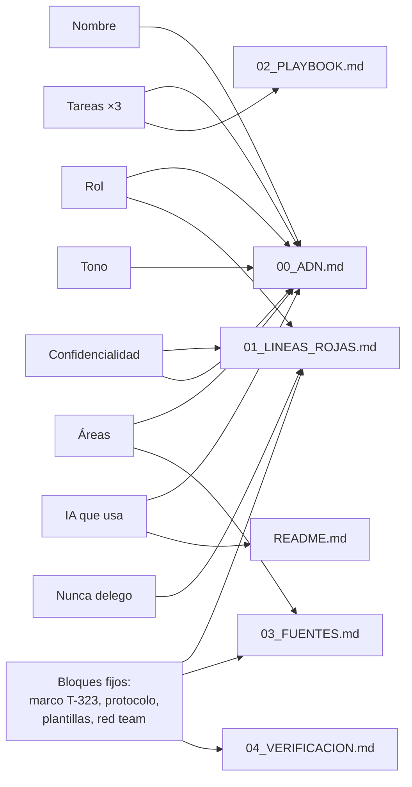

# Cerebro Jurídico

> **Documento maestro del taller.** Contiene todo lo necesario para que la plataforma genere la presentación, el playbook y el escenario práctico: fundamentos de IA explicados para abogados, la arquitectura del "cerebro", el guion minuto a minuto, la lógica completa del ejercicio interactivo, la demo de escalamiento (Obsidian → NotebookLM → IA con manos), la comparación entre modelos, el protocolo de verificación, los riesgos y el plan B.

## Cómo leer este documento

| Sección | Alimenta a | Uso |
|---|---|---|
| 1–2 Ficha, tesis y marco DOTS | Presentación (apertura), playbook (portada) | Mensaje central y posicionamiento |
| 3 Fundamentos de IA | Presentación (bloque conceptual), playbook (capítulo 1) | Los conceptos elementales con los que se construye el cerebro |
| 4 Arquitectura del cerebro | Presentación, playbook (capítulo 2), ejercicio | Los cinco archivos y los niveles de madurez |
| 5 Guion del taller | Presentación (orden y tiempos), notas del orador | Minuto a minuto |
| 6 Paso 1 · Ejercicio interactivo | Landing, playbook (capítulo 3) | Lógica completa de la generación personalizada |
| 7 Paso 2 · Demo de escalamiento | Notas del orador, playbook (capítulo 4) | Lo que Fabián muestra y lo que se llevan a casa |
| 8 Verificación y red team | Presentación, playbook (capítulo 5) | El reflejo que debe quedar instalado |
| 9 Playbook | Playbook | Estructura y formatos del entregable |
| 10 Diapositivas | Presentación | Guion de cada diapositiva con nota del orador |
| 11–15 Logística, posicionamiento, glosario, referencias, pendientes | Preparación | Lo que falta validar antes del evento |

**Convenciones de etiquetas** (para que la plataforma distinga capas):

- `[GUION]` — lo que dice Fabián, en primera persona.
- `[PANTALLA]` — lo que se proyecta.
- `[SALA]` — lo que hacen los asistentes.
- `[DEMO]` — acción de Fabián en su equipo.
- `[RIESGO]` — punto de falla y plan B.
- `[PLAYBOOK]` — contenido que va al entregable.
- `[VALIDAR]` — dato o comportamiento que Fabián debe confirmar antes del evento.

---

## 1. Ficha del taller

| Campo | Dato |
|---|---|
| Evento | Clase abierta: Innovación y tecnología para los servicios jurídicos |
| Pregunta guía del evento | ¿Cómo están cambiando la innovación y la tecnología la forma de prestar servicios jurídicos? |
| Organizan | Jordan Rojas (Charla Legal) y Julian David Molina Coral |
| Lugar | Auditorio Félix Restrepo S.J., Pontificia Universidad Javeriana, Ak 7 # 40-62, Bogotá |
| Fecha | `[VALIDAR]` No aparece en el texto de la página de Luma; confirmar |
| Agenda | 14:00 panel · 15:00 taller Dayanne Rojas ("IA y automatizaciones para el negocio jurídico") · **15:30 taller Fabián Zapata** · 16:00 cierre (Jordan Rojas) |
| Requisito publicado | "Trae tu computador para los talleres" |
| Inscritos | ~94 al momento de la consulta |
| Público | Mixto: litigantes, abogados de firma, in-house, sector público, emprendedores legaltech, estudiantes. Nivel de IA heterogéneo; casi todos ya usan algún chat de IA |
| Lo que NO es este taller | Automatización de back-office (CRM, facturación, flujos n8n): ese es el taller anterior. Tampoco "cómo redactar un documento con un prompt": eso ya lo saben |
| Lo que SÍ es | Cómo diseñar un sistema personal de IA jurídica confiable: contexto propio, procedimientos propios, líneas rojas y verificación, portable entre Claude, ChatGPT, Gemini y modelos locales |

### Objetivos

1. **Un activo, no tips.** Cada asistente sale con sus cinco archivos de cerebro jurídico generados a partir de su perfil, cargados o listos para cargar en la IA que ya usa.
2. **Un reflejo.** Verificar antes de usar. Que la frase "Verificación pendiente" quede asociada a cualquier salida de IA.
3. **Un horizonte.** Ver, con un caso real anonimizado, cómo ese mismo paquete de archivos escala a una bóveda de conocimiento (Obsidian), a un lector que no inventa (NotebookLM) y a una IA que lee y escribe dentro del sistema del abogado (MCP).
4. **Un posicionamiento.** Fabián Zapata / GLab / Zeta como el perfil técnico que diseña arquitectura jurídica con IA, complementario a los abogados innovadores del panel.

### Qué se lleva cada asistente

- Sus archivos: `00_ADN.md`, `01_LINEAS_ROJAS.md`, `02_PLAYBOOK.md`, `03_FUENTES.md`, `04_VERIFICACION.md`, `README.md`.
- La bóveda plantilla de Obsidian con plantillas y consultas listas.
- La guía de NotebookLM con las cinco fuentes oficiales que debe cargar.
- La configuración exacta del "Nivel 3" para cuando esté listo.
- El playbook completo (web + PDF) con el protocolo de verificación.

---

## 2. Tesis y marco DOTS

### 2.1 La tesis en una frase

> **"La IA no es tu abogado junior; es tu sistema. Y los sistemas se diseñan."**

Variantes para distintos momentos:

- Apertura: "Deja de usar la IA como un oráculo. Empieza a diseñarla como un sistema."
- Puente desde el taller anterior: "Dayanne les mostró cómo la IA mueve el negocio. Ahora vamos a diseñar cómo piensa."
- Cierre: "La herramienta va a cambiar el año entrante. Su cerebro, no. Lo que construyeron hoy se lo llevan a cualquier IA."

### 2.2 El diagnóstico que justifica la tesis

| Hecho | Dato | Fuente |
|---|---|---|
| Adopción masiva | 79 % de los profesionales legales usa IA | Clio, Legal Trends Report 2025 (1.702 profesionales, EE. UU.) |
| Sin sistema | Solo 40 % usa una solución jurídica específica (bajó del 58 % en 2024); el resto usa chats genéricos | Clio, 2025 |
| Sin estrategia | Solo 22 % de las organizaciones tiene una estrategia de IA visible y definida; quienes la tienen son 3,5 veces más propensos a obtener beneficios críticos | Thomson Reuters, Future of Professionals 2025 (2.275 encuestados) |
| Riesgo concreto | Más de 2.000 decisiones judiciales en el mundo con citas o contenidos alucinados por IA registradas en 2026 | Base de datos de Damien Charlotin (HEC Paris) |
| No basta la herramienta | Caso del Quinto Circuito (EE. UU., feb. 2026): el abogado usó herramientas jurídicas especializadas y aun así presentó citas fabricadas | Trackers secundarios; ver referencias |
| Colombia ya fijó reglas | Sentencia T-323 de 2024 (Corte Constitucional) y Acuerdo PCSJA24-12243 (Consejo Superior de la Judicatura) | Fuentes oficiales |

`[GUION]` "Casi todos ustedes ya usan IA. Pocos tienen un sistema. Y la diferencia entre usar y tener un sistema es la diferencia entre una sanción y una ventaja."

### 2.3 Marco DOTS

`[VALIDAR]` "DOTS" no es un marco establecido en la literatura de IA jurídica; se presenta como marco propio de GLab. Fabián decide si lo adopta con este nombre.

```
   D ──────── O ──────── T ──────── S
 Datos     Orquestación  Tools    Supervisión
 propios   (qué hace la  (skills,  (verificación,
 (fuente   IA y qué hago conectores, líneas rojas,
 de verdad) yo, en qué   modelos)  trazabilidad)
            orden)
```

| Letra | Pregunta que responde | Archivo del cerebro que lo materializa | Concepto de IA detrás |
|---|---|---|---|
| **D** · Datos / Documentos | ¿Con qué fuentes razona la IA? | `03_FUENTES.md` (+ bóveda, NotebookLM) | Contexto, RAG, corte de conocimiento |
| **O** · Orquestación | ¿Qué pasos hace la IA, dónde se detiene, qué decido yo? | `02_PLAYBOOK.md` (skills con puntos YO DECIDO) | Agentes, flujos humano-máquina |
| **T** · Tools / Skills | ¿Qué habilidades reutilizables y qué conectores tiene? | `02_PLAYBOOK.md`, MCP, modelos por nivel de confidencialidad | Skills, herramientas, MCP, modelos locales |
| **S** · Supervisión | ¿Cómo sé que no me está engañando y quién responde? | `01_LINEAS_ROJAS.md`, `04_VERIFICACION.md` | Alucinación, verificación, T-323 |

Y el `00_ADN.md` es el centro: quién soy, cómo trabajo, qué espero. Sin ADN, los otros cuatro no tienen a quién servir.



---

## 3. Fundamentos de IA para construir un cerebro

> Esta sección es la base conceptual. Cada concepto sigue la misma estructura: **definición en una frase**, **analogía jurídica**, **diagrama**, **qué implica para el cerebro** y **mito vs. realidad**. En la presentación caben de forma comprimida (sección 10); en el playbook van completos.

### 3.1 Qué es un modelo de lenguaje

**Definición.** Un modelo de lenguaje (LLM) es un sistema que, dado un texto, calcula cuál es la continuación más probable, palabra por palabra (en realidad, *token* por token). No consulta una base de datos; completa patrones aprendidos de una cantidad enorme de texto.

**Analogía jurídica.** Es el pasante más leído del mundo, que estudió toda la biblioteca hasta cierta fecha, pero **no tiene el expediente en la mano**. Si le preguntas "¿cuál es el término para responder un derecho de petición?", responde con lo que más veces leyó, no con lo que hoy rige.

**Diagrama.**

```
Entrada:  "El término para responder una petición de documentos es de ___ días"

El modelo calcula probabilidades para la siguiente palabra:

   diez    ████████████████████████░░░░░░░░   (lo correcto hoy, Ley 1755 art. 14)
   veinte  ██████████████░░░░░░░░░░░░░░░░░░   (Decreto 491 de 2020, ya sin vigencia)
   quince  ████████░░░░░░░░░░░░░░░░░░░░░░░░   (término general, no el de documentos)
   treinta ██████░░░░░░░░░░░░░░░░░░░░░░░░░░   (consultas, o el general ampliado)

→ Elige una (con algo de azar) y sigue escribiendo como si fuera cierta.
```

**Qué implica para el cerebro.** El modelo no "sabe": estima. Si tu fuente de verdad está en la mesa (en el contexto), la estimación se alinea con ella. Si no está, completa con lo que leyó. Por eso existe `03_FUENTES.md`.

| Mito | Realidad |
|---|---|
| "La IA busca la respuesta en internet" | Por defecto no busca nada; genera texto. Algunas herramientas agregan búsqueda, pero el modelo base no la tiene |
| "Si lo dice con seguridad, es cierto" | El tono seguro es un patrón aprendido, no una medida de certeza |
| "Es como Google" | Google indexa documentos reales; un LLM produce texto nuevo que *parece* un documento real |

### 3.2 Tokens y ventana de contexto: la mesa de trabajo

**Definición.** El modelo no lee letras ni palabras completas, sino *tokens* (fragmentos de palabra). Todo lo que puede "ver" en un momento dado cabe en su *ventana de contexto*: instrucciones, archivos cargados, la conversación y su propia respuesta.

**Analogía jurídica.** La ventana de contexto es **la mesa de trabajo**. Lo que está sobre la mesa, el modelo lo lee. Lo que quedó en el archivador (otra conversación, un documento no cargado), no existe para él.

```
┌──────────────────────── VENTANA DE CONTEXTO (la mesa) ────────────────────────┐
│                                                                               │
│  [Instrucciones de sistema]  [00_ADN] [01_LINEAS_ROJAS] [02_PLAYBOOK]         │
│  [03_FUENTES] [04_VERIFICACION]   [El expediente que subiste]                 │
│  [Tu pregunta]  →  [La respuesta se escribe aquí mismo]                       │
│                                                                               │
└───────────────────────────────────────────────────────────────────────────────┘
        Fuera de la mesa: otros chats, archivos no cargados, lo que dijiste ayer.
```

**Órdenes de magnitud (aproximados, en español).**

| Texto | Tokens aprox. |
|---|---|
| Una página de escrito jurídico | 600–800 |
| Los cinco archivos del cerebro | 6.000–9.000 |
| Una sentencia de 40 páginas | 25.000–32.000 |
| Un expediente de 500 folios | 350.000+ |
| Ventana de los modelos actuales (2026) | entre ~128.000 y más de 1.000.000 según el modelo |

**Qué implica para el cerebro.** Los cinco archivos caben en cualquier mesa moderna con espacio de sobra. El expediente completo, a veces no: por eso existen las fuentes cargadas con recuperación (3.8) y las fichas resumidas en la bóveda (7.2).

| Mito | Realidad |
|---|---|
| "Ya le dije eso la semana pasada" | Cada chat nuevo arranca con la mesa vacía, salvo que uses Proyectos, Gems o memoria (3.6) |
| "Le subí 300 páginas, las leyó todas" | Depende de la herramienta: algunas leen todo si cabe, otras buscan fragmentos (3.8). La mesa tiene límite |

### 3.3 Entrenamiento, corte de conocimiento e inferencia

**Definición.** El modelo se *entrena* una vez con textos hasta una fecha (el *corte de conocimiento*). Después solo *infiere*: responde con lo que aprendió. No se actualiza solo.

**Analogía jurídica.** La biblioteca cerró en una fecha. Todo lo que se publicó después (una ley que restableció términos, una sentencia de unificación) **no está en los estantes**, salvo que tú lo pongas sobre la mesa.

```
2011 ─── 2015 ─────── 2020 ────── 2022 ──────────── corte del modelo ──── hoy
 │        │            │            │                       │               │
 CPACA   Ley 1755     Decreto 491  Ley 2207               la biblioteca     tú preguntas
 (1437)  (términos    (amplía      (restablece             cierra aquí      por el término
         del derecho   términos:    los términos                           vigente
         de petición)  30/20/35)    de la Ley 1755)

 Si el modelo leyó mucho sobre el Decreto 491 (pandemia, miles de textos)
 y poco sobre la Ley 2207 (una ley corta, poco comentada),
 su "patrón más probable" puede ser el término ampliado.
```

**Qué implica para el cerebro.** Tu `03_FUENTES.md` es la actualización que el modelo no tiene. Una línea que diga "Decreto 491 sin vigencia desde la Ley 2207 de 2022" corrige el patrón en todos los modelos a la vez.

### 3.4 Alucinación: completar el patrón

**Definición.** Una alucinación es una salida fluida, coherente y falsa. No es una mentira (no hay intención): es el modelo completando un patrón cuando no tiene el dato.

**Analogía jurídica.** Una cita de sentencia tiene una forma muy estable: *"Corte Constitucional, Sentencia T-### de 20##, M.P. Nombre Apellido"*. El modelo aprendió la **forma** perfectamente. Cuando le pides una sentencia sobre un tema de nicho, produce la forma y rellena los huecos con lo probable: un número plausible, un magistrado real, una fecha coherente. El resultado parece verdadero y no existe.

```
Pregunta: "Dame la sentencia que resolvió X"

   ¿Tiene el dato en el contexto? ──sí──▶ lo cita (y aun así, verifica)
            │
            no
            ▼
   ¿Reconoce que no sabe? ──a veces──▶ "no tengo la fuente exacta"   ← lo que queremos
            │
            casi siempre
            ▼
   Completa el patrón: "Sentencia T-412 de 2019, M.P. ..."  ← existe la forma, no el fondo
```

**Datos duros.**

- Más de 2.000 decisiones judiciales en el mundo documentan citas o contenidos inventados por IA (base de Damien Charlotin, 2026).
- *Mata v. Avianca* (Nueva York, 2023): sanción de USD 5.000 a abogados que presentaron seis sentencias inexistentes generadas por ChatGPT. Es el caso fundacional.
- Quinto Circuito (EE. UU., feb. 2026): citas fabricadas pese a usar herramientas jurídicas especializadas. **La herramienta no sustituye el protocolo.**
- Colombia: la Sentencia T-323 de 2024 nació de un juez que usó ChatGPT para motivar una tutela. La Corte no prohibió la IA; exigió transparencia, responsabilidad, verificación y no sustitución del razonamiento humano.

**Qué implica para el cerebro.** Tres defensas, en orden: (1) regla de sistema "nunca inventes citas; si no tienes el dato exacto, dilo" (en `00_ADN`); (2) fuente de verdad en la mesa (`03_FUENTES`); (3) protocolo de verificación antes de usar (`04_VERIFICACION`). Ninguna sola basta.

| Mito | Realidad |
|---|---|
| "Las herramientas jurídicas no alucinan" | Reducen el riesgo, no lo eliminan; hay sanciones con herramientas especializadas |
| "Le pido que no invente y ya" | Ayuda, pero sin fuente en la mesa el modelo sigue completando patrones |
| "Si verifico una cita, verifiqué todo" | Verifica también que la sentencia diga lo que la IA dice (ratio vs. obiter) y que siga vigente |

### 3.5 Prompt, instrucciones de sistema y roles

**Definición.** Lo que llega al modelo tiene capas: las *instrucciones de sistema* (quién es, qué reglas sigue; las fija quien configura), el *contexto* (archivos, documentos) y el *mensaje del usuario* (la pregunta). El modelo pondera todo, pero las instrucciones de sistema actúan como marco persistente.

**Analogía jurídica.** Instrucciones de sistema = el **contrato de vinculación del pasante**: a quién le responde, qué puede y qué no puede hacer, cómo entrega. Contexto = el **expediente** que le pasas. Mensaje = la **orden del día**.

```
┌─────────────────────────────────────────────────────┐
│ CAPA 1 · Instrucciones de sistema (persistentes)    │  ← bloque de 00_ADN.md
│  "Eres mi asistente jurídico. Trabajo en Colombia   │     (va en el Proyecto,
│   como ... Reglas: 1) jurisdicción Colombia ...     │      la Gem o el GPT)
│   3) nunca inventes citas ... 7) cierra con         │
│   'Verificación pendiente'"                         │
├─────────────────────────────────────────────────────┤
│ CAPA 2 · Contexto (archivos y documentos)           │  ← los cinco .md
│  01_LINEAS_ROJAS · 02_PLAYBOOK · 03_FUENTES ·       │     + el expediente del caso
│  04_VERIFICACION · expediente CLIENTE-01            │
├─────────────────────────────────────────────────────┤
│ CAPA 3 · Mensaje del usuario (cambia cada vez)      │  ← "Aplica la skill de
│  "Aplica la skill de peticiones a esta solicitud"   │     peticiones a..."
└─────────────────────────────────────────────────────┘
```

**Qué implica para el cerebro.** El abogado deja de escribir prompts largos: el trabajo pesado está en las capas 1 y 2, escritas una vez. La capa 3 se vuelve una orden corta.

### 3.6 Contexto vs. memoria: Proyectos, Gems y GPTs

**Definición.** Un chat olvida al cerrarse. Las herramientas ofrecen tres formas de persistencia: **espacios con instrucciones y archivos fijos** (Claude Projects, ChatGPT Projects, Gemini Gems, Custom GPTs), **memoria** (notas que la herramienta guarda de lo que le dijiste) y **archivos tuyos** que vuelves a cargar.

**Analogía jurídica.** La memoria de la herramienta es como las notas que el pasante toma por su cuenta: útiles, pero no las controlas ni las puedes auditar. Tus archivos son **tu archivo físico**: están donde tú dices, los revisas, los llevas a otra oficina.

| Herramienta | Dónde van las instrucciones | Dónde van los archivos | Disponibilidad `[VALIDAR la semana del evento]` |
|---|---|---|---|
| Claude · Proyectos | "Instrucciones del proyecto" | "Conocimiento" | Plan gratuito con límite de proyectos; ilimitado en Pro |
| ChatGPT · Proyectos | Instrucciones del proyecto | Archivos del proyecto (pocos en gratuito) | Proyectos en gratuito; **crear Custom GPTs** requiere plan de pago |
| Gemini · Gems | Instrucciones de la Gem | Archivos de la Gem (según plan) | Gems en gratuito |
| Copilot (M365) | Primer mensaje / instrucciones | SharePoint / OneDrive | Según licencia de la organización |
| Modelo local (Ollama, LM Studio) | "System prompt" | Primer mensaje o carpeta local | Gratuito; depende del equipo |

**Qué implica para el cerebro.** Las cinco herramientas aceptan el mismo paquete de archivos. **El activo es el paquete, no el espacio.** Cuando cambies de herramienta, cargas los mismos archivos y sigues.

| Mito | Realidad |
|---|---|
| "Mi GPT personalizado es mi cerebro" | Es una vitrina de tu cerebro en una sola tienda. Si cambias de proveedor, lo pierdes; los archivos no |
| "La memoria del chat ya me conoce" | Guarda fragmentos que no controlas; no es auditable ni portable |

### 3.7 De la ingeniería de prompts a la ingeniería de contexto

**Definición.** *Prompt engineering*: redactar cada vez la pregunta perfecta. *Context engineering*: diseñar una vez qué información, reglas y procedimientos ve el modelo, para que cualquier pregunta simple salga bien.

```
ANTES (prompt engineering)                 DESPUÉS (context engineering)
─────────────────────────────              ───────────────────────────────────
Cada vez:                                  Una vez:
 "Actúa como abogado experto en             00_ADN · 01_LINEAS_ROJAS ·
  derecho administrativo colombiano,        02_PLAYBOOK · 03_FUENTES ·
  con 20 años de experiencia, redacta       04_VERIFICACION
  en tono formal, cita solo normas
  vigentes, no inventes, al final           Cada vez:
  dime qué debo verificar, ..."              "Aplica la skill de peticiones a esto."
  (300 palabras, se olvidan cosas)           (8 palabras, no se olvida nada)
```

**Analogía jurídica.** Nadie le explica al pasante cada mañana quién es la firma, cómo se citan las sentencias y qué no puede firmar. Se le entrega un manual el primer día. El cerebro es ese manual.

**Qué implica para el cerebro.** El taller no enseña "a pedir mejor"; enseña a **escribir el manual**. Y la landing lo escribe por ellos a partir de su perfil.

### 3.8 Fuentes cargadas, recuperación (RAG) y "libro abierto"

**Definición.** Cuando subes documentos, muchas herramientas no los ponen enteros en la mesa: los parten en fragmentos, los convierten en vectores numéricos (*embeddings*) que capturan significado, y cuando preguntas **recuperan** los fragmentos más cercanos a tu pregunta y se los pasan al modelo. Eso es RAG (*retrieval-augmented generation*). NotebookLM es el ejemplo más puro: responde **solo** con tus fuentes y ancla cada afirmación al párrafo.

```
Tus fuentes (PDF oficiales)
   │  1. partir en fragmentos
   ▼
[frag 1][frag 2][frag 3] ... [frag 480]
   │  2. convertir cada fragmento en un vector de significado
   ▼
   •  •    •         •  •                 ← puntos cercanos = significado cercano
      •  •      •        •
   │  3. tu pregunta también se convierte en vector
   ▼
"¿término para petición de documentos?"  →  ★
   │  4. se recuperan los fragmentos más cercanos a ★
   ▼
[frag 212: Ley 1755 art. 14 num. 1] [frag 219: Ley 2207 art. 1]
   │  5. el modelo responde SOLO con eso y cita el fragmento
   ▼
"10 días (Ley 1755 de 2015, art. 14, num. 1) [fuente 2, p. 4]"
```

**Analogía jurídica.** Examen a libro abierto, pero el libro lo escogiste tú. El modelo puede ser brillante o mediocre; si solo puede citar tu libro, no inventa un libro.

**Qué implica para el cerebro.** `03_FUENTES.md` es la versión mínima del libro abierto (cabe en la mesa). NotebookLM es la versión escalada (cientos de páginas con cita al párrafo). La bóveda de Obsidian es donde el libro vive y crece.

| Mito | Realidad |
|---|---|
| "Subí el PDF, así que la IA lo leyó todo" | Con recuperación, solo ve los fragmentos que juzgó relevantes; puede perderse una excepción en otra página |
| "RAG elimina las alucinaciones" | Las reduce mucho cuando la herramienta se limita a las fuentes (NotebookLM). Un chat general con archivos puede mezclar lo cargado con lo aprendido |

### 3.9 Agentes, herramientas y MCP: la IA con manos

**Definición.** Un *agente* es un modelo que, además de escribir, puede **actuar**: llamar herramientas (leer un archivo, consultar una página, escribir un documento), observar el resultado y decidir el siguiente paso, en un ciclo. **MCP** (Model Context Protocol) es el estándar abierto que define cómo se conectan esas herramientas: un "USB-C" para IA. Un servidor MCP expone capacidades (leer tu carpeta, consultar la Rama Judicial); el modelo las usa con tu autorización.

```
            ┌──────────────── ciclo del agente ────────────────┐
            │                                                  │
   Orden ──▶│  PENSAR  ──▶  ACTUAR (herramienta)  ──▶ OBSERVAR │──▶ Resultado
            │     ▲                                      │     │
            │     └──────────────────────────────────────┘     │
            └──────────────────────────────────────────────────┘
                                   │
                        ┌──────────┴──────────┐
                        │   Servidores MCP     │
                        ├──────────────────────┤
                        │ • Sistema de archivos│ ← tu bóveda /cerebro-juridico
                        │ • Rama Judicial      │ ← consulta por radicado (p. ej. Croma)
                        │ • Calendario         │ ← vencimientos
                        └──────────────────────┘
                 Cada acción de escritura pide tu aprobación.
```

**Analogía jurídica.** Hasta aquí el pasante solo dictaba. Con herramientas, **abre el archivador, saca la ficha, redacta el borrador y lo deja en la carpeta del caso**. Y tú apruebas cada vez que va a guardar algo.

**Qué implica para el cerebro.** Es el Nivel 3 de la demo (7.4): la IA lee `02_PLAYBOOK` y `03_FUENTES` desde la bóveda, aplica la skill y guarda el borrador en `10_CASOS/`. Deja de ser un chat; se vuelve un colaborador dentro de tu sistema.

### 3.10 Skills: procedimientos escritos

**Definición.** Una *skill* es un procedimiento reutilizable, escrito en lenguaje natural, que el modelo sigue cuando la tarea coincide: cuándo aplica, qué entradas necesita, qué pasos ejecuta, dónde se detiene y qué se verifica. En 2026 los proveedores adoptaron esta idea (el plugin jurídico de Claude se apoya en *playbooks* de la organización para clasificar cláusulas en verde, amarillo o rojo).

**Estructura de una skill del cerebro.**

```
## Skill: <nombre>
Cuándo: <situación que la activa>
1. YO entrego: <datos, siempre anonimizados>
2. IA hace: <pasos concretos y formato de salida>
3. YO DECIDO: <el punto donde se detiene>
4. VERIFICO: <qué compruebo y dónde>
```

**Analogía jurídica.** Es el protocolo de la firma para "revisar un NDA": no se improvisa cada vez, se sigue. La diferencia es que ahora el protocolo lo lee también la máquina.

### 3.11 Nube vs. local: el modelo según la confidencialidad

**Definición.** Los modelos en la nube (Claude, ChatGPT, Gemini, Copilot) procesan tus datos en servidores del proveedor; las condiciones de retención y entrenamiento dependen del plan. Los modelos *abiertos* (Llama, Qwen, DeepSeek, Mistral) se pueden ejecutar **en tu propio equipo** con Ollama o LM Studio: más lentos y menos precisos, pero nada sale de tu máquina.

| Nivel de confidencialidad | Qué es | Qué modelo | Regla del cerebro |
|---|---|---|---|
| Público o propio | Normas, sentencias, tus plantillas, tus escritos sin datos de terceros | Cualquiera | Igual, sin datos personales innecesarios |
| Reservado (datos de terceros) | Expedientes con partes identificables, contratos con NIT | Nube **con anonimización** (CLIENTE-01, CONTRAPARTE-01) y plan que no entrene con tus datos | Anonimizar antes de subir; nada completo en cuentas gratuitas |
| Secreto profesional / reserva legal | Estrategia del cliente, penal en investigación, familia, menores | Modelo local, o plan empresarial con contrato de no retención | Nunca en nube con cuenta personal |

**Analogía jurídica.** No todos los documentos salen de la oficina. Algunos se consultan solo en la sala de la firma. El modelo local es la sala de la firma.

**Qué implica para el cerebro.** `01_LINEAS_ROJAS.md` fija el nivel. El resto del cerebro **no cambia**: el mismo `02_PLAYBOOK` y `03_FUENTES` se cargan en el modelo local. Cambia el modelo, no el método.

### 3.12 Por qué dos modelos (o el mismo dos veces) responden distinto

**Definición.** Tres razones: (1) **datos de entrenamiento** distintos y cortes distintos; (2) **muestreo**: el modelo elige entre varias continuaciones probables con algo de azar (la "temperatura"), así que la misma pregunta da respuestas distintas; (3) **instrucciones** distintas de cada proveedor.

**Qué implica para el cerebro.** Dos consecuencias prácticas:

- La verificación no es opcional ni depende del proveedor. Es el mismo protocolo para todos.
- La diferencia se puede usar a favor: **red team**. Pídele a un segundo modelo que ataque la respuesta del primero (8.3).

**Qué se verá en la grilla de modelos del taller (7.5).** Con el cerebro cargado, las cuatro respuestas convergen en el fondo (10 días, Ley 1755 art. 14) y difieren en forma: extensión, orden, si abren con la conclusión, cuánto explican la vigencia. Sin el cerebro, pueden divergir en el fondo.

### 3.13 Supervisión humana: lo que exige el derecho colombiano

| Instrumento | Qué fija | Cómo lo materializa el cerebro |
|---|---|---|
| **Sentencia T-323 de 2024** (Corte Constitucional) | La IA puede apoyar, no sustituir el razonamiento humano. Principios: transparencia, responsabilidad, privacidad, no sustitución, seriedad y verificación, prevención de riesgos, igualdad y equidad. Ordena lineamientos al CSJ | Puntos **YO DECIDO** en cada skill; cierre "Verificación pendiente"; reglas de anonimización |
| **Acuerdo PCSJA24-12243** (CSJ, 16 dic. 2024) | Lineamientos para uso responsable, seguro y ético de IA generativa en la Rama Judicial; supervisión humana; restricciones a herramientas sin garantías de protección de datos | Niveles de confidencialidad; modelo local para reserva |
| **Ley 1581 de 2012 y Decreto 1377 de 2013** | Protección de datos personales | Regla de anonimización antes de subir |
| **Art. 74 C.P. y Ley 1123 de 2007** | Secreto profesional inviolable; deberes del abogado | Línea roja: nada bajo secreto profesional en nube con cuenta personal |
| **ABA Formal Opinion 512** (EE. UU., 2024), referencia comparada | Competencia, confidencialidad, comunicación al cliente, franqueza ante el tribunal, supervisión | Protocolo de verificación; informar al cliente del uso de IA |

`[GUION]` "La Corte Constitucional ya lo dijo en la T-323: la IA puede ayudar, pero el que firma, decide y responde es el abogado. El cerebro no es para que la IA haga su trabajo. Es para que usted siga siendo el que decide, con menos tiempo perdido."

### 3.14 Mapa conceptual: cómo se conectan los fundamentos con el cerebro




---

## 4. Arquitectura del cerebro jurídico

### 4.1 Principio

> El activo no es la herramienta. Es **el contexto portable del abogado**: un paquete de archivos de texto que cualquier IA puede leer y que vive fuera de cualquier proveedor.

Tres propiedades que lo definen:

1. **Portable.** El mismo paquete se carga en Claude, ChatGPT, Gemini, Copilot o un modelo local.
2. **Auditable.** Es texto. El abogado lo lee, lo corrige y sabe exactamente qué sabe su IA.
3. **Acumulativo.** Cada error de la IA se convierte en una línea nueva del playbook o de las fuentes. El cerebro mejora con el uso; el chat no.

### 4.2 Los cinco archivos

```
/cerebro-juridico
├── README.md             ← cómo cargarlo y mantenerlo
├── 00_ADN.md             ← quién soy, cómo trabajo, instrucciones de sistema
├── 01_LINEAS_ROJAS.md    ← lo que la IA nunca hace, lo que yo nunca delego, confidencialidad
├── 02_PLAYBOOK.md        ← mis skills: procedimientos para las tareas que más tiempo me quitan
├── 03_FUENTES.md         ← mi fuente de verdad: normas y sentencias que yo verifiqué
└── 04_VERIFICACION.md    ← el protocolo antes de firmar, radicar o enviar
```

| Archivo | Responde a | Contiene | No contiene | Letra DOTS |
|---|---|---|---|---|
| `00_ADN.md` | ¿Quién soy y qué es un buen trabajo para mí? | Rol, áreas, tareas, herramientas, tono, "qué es un buen trabajo", **bloque de instrucciones de sistema** listo para copiar | Datos de clientes; nada que cambie cada semana | centro |
| `01_LINEAS_ROJAS.md` | ¿Qué nunca pasa? | Nivel de confidencialidad y sus reglas; lo que nunca delego; lo que la IA nunca hace; marco colombiano (T-323, PCSJA24-12243, Ley 1581, art. 74 C.P.) | Procedimientos (van al playbook) | S |
| `02_PLAYBOOK.md` | ¿Cómo hago cada tarea? | Una skill por tarea con YO entrego / IA hace / YO DECIDO / VERIFICO; tabla de posiciones (verde/amarillo/rojo) cuando aplica; cómo agregar skills | Fuentes (van a 03) | O · T |
| `03_FUENTES.md` | ¿Con qué razona la IA? | Dónde verifico; semilla de normas por área marcada "verificar vigencia"; entradas verificadas con plantilla fija; alertas de vigencia | Nada que el abogado no haya abierto y verificado | D |
| `04_VERIFICACION.md` | ¿Cómo sé que puedo usarlo? | Checklist por sentencia, por norma, por cálculo de términos; red team con segundo modelo; registro | Opiniones | S |

### 4.3 Ejemplo completo: el cerebro de "Laura", litigante civil y constitucional

> Perfil usado como caso demo y como precarga de la landing. Nombre ficticio. Sirve para la presentación (mostrar extractos) y para el playbook (mostrar un cerebro terminado).

**Perfil:** litigante independiente · civil y comercial + constitucional y tutelas · tareas: revisión de contratos, investigación de jurisprudencia, derechos de petición · usa Claude y ChatGPT · confidencialidad: reservada · tono: claro y didáctico · nunca delega: "decidir si presento el recurso o acepto la conciliación".

**Extracto de `00_ADN.md` (bloque de sistema):**

```
Eres mi asistente jurídico. Trabajo en Colombia como abogado/a litigante con práctica
propia, con práctica en civil y comercial, constitucional y tutelas. Llámame Laura.

REGLAS
1. Jurisdicción por defecto: Colombia. Si usas derecho comparado o doctrina extranjera,
   márcalo como tal.
2. Fuente de verdad: antes de afirmar una regla jurídica, revisa 03_FUENTES.md. Si la
   fuente no está allí, responde igual pero marca la afirmación con [NO VERIFICADO].
3. Citas: nunca inventes sentencias, radicados, magistrados ponentes, fechas ni
   artículos. Si no tienes el dato exacto, di "no tengo la fuente exacta" en lugar de
   completarlo.
4. Confidencialidad: asume que todo lo que te paso viene anonimizado con códigos
   (CLIENTE-01, CONTRAPARTE-01). Si ves nombres, cédulas o NIT reales, detente y pídeme
   que los reemplace antes de continuar.
5. Tono: claro y didáctico; explica cada término técnico la primera vez que aparece.
   Formato: resumen en tres líneas al inicio y luego el desarrollo con subtítulos.
6. Procedimientos: para las tareas descritas en 02_PLAYBOOK.md sigue sus pasos y
   detente en cada punto marcado YO DECIDO.
7. Cierre obligatorio: termina toda respuesta jurídica con una sección "Verificación
   pendiente" que liste lo que debo confirmar antes de usarla.
8. Nunca presentes un borrador como definitivo. Yo firmo, radico y decido.
```

**Extracto de `01_LINEAS_ROJAS.md`:**

```
## Lo que nunca delego
- Decidir si presento el recurso o acepto la conciliación.
- La estrategia procesal: qué pretender, qué recurso interponer y cuándo.
- Firmar, radicar o enviar algo que no leí completo.
- Aceptar una cita que no abrí en la fuente oficial.
- Contar un término sin el calendario oficial de festivos en la mano.
```

**Extracto de `03_FUENTES.md` (entrada verificada):**

```
## Entrada verificada: derecho de petición
- Tipo: norma
- Identificación: Ley 1755 de 2015, art. 14 (sustituyó el Título II de la Ley 1437
  de 2011, CPACA).
- Regla extraída: término general de 15 días; peticiones de documentos e información,
  10 días (si no hay respuesta, se entiende aceptada y los documentos se entregan en
  los 3 días siguientes); consultas, 30 días. Días hábiles.
- Alerta de vigencia: el Decreto Legislativo 491 de 2020 amplió estos términos durante
  la emergencia (30, 20 y 35 días). La Ley 2207 de 2022 restableció los originales.
  Una IA que responda con los términos ampliados está desactualizada.
- Verificado por: Laura   Fecha: ______   Enlace oficial: ______
```

### 4.4 Cómo se carga

**Camino universal (cualquier IA, cualquier plan).** Pegar como primer mensaje de un chat nuevo:

```
Este es mi cerebro jurídico. Léelo completo. Antes de responder cualquier cosa,
confírmame en tres líneas: quién soy, cuáles son mis líneas rojas y cómo vas a
verificar tus respuestas. Luego espera mi primera pregunta.

===== 00_ADN.md =====
...
===== 01_LINEAS_ROJAS.md =====
...
(los cinco archivos)
```

La confirmación en tres líneas es deliberada: obliga al modelo a procesar el paquete antes de la primera pregunta y le muestra al abogado, en 10 segundos, si la carga funcionó.

**Caminos para dejarlo fijo.** Ver tabla 3.6 y pasos detallados en 6.12.

### 4.5 Cómo se mantiene

```
La IA se equivocó
      │
      ├── ¿fue de procedimiento (hizo un paso mal, omitió una verificación)?
      │        └──▶ corrige 02_PLAYBOOK.md (agrega un paso o una advertencia a la skill)
      │
      ├── ¿fue de fuente (norma derogada, sentencia mal citada)?
      │        └──▶ corrige 03_FUENTES.md (agrega la entrada verificada o la alerta de vigencia)
      │
      └── ¿fue de límite (pidió datos que no debía, cruzó una línea)?
               └──▶ corrige 01_LINEAS_ROJAS.md y la regla correspondiente en 00_ADN.md
```

Regla: **`03_FUENTES.md` solo crece con lo que el abogado abrió y verificó.** Nunca con lo que la IA dijo.

### 4.6 Niveles de madurez

```
Nivel 5 ─ Agentes multi-paso con supervisión            ┌──────────┐
          (sistemas como GJD: agente de normatividad,   │ horizonte│
          agente decisor)                               └──────────┘
Nivel 4 ─ IA con manos: lee y escribe en la bóveda       ┌──────────┐
          vía MCP; consulta fuentes oficiales en vivo    │ demo N3  │
                                                         └──────────┘
Nivel 3 ─ Lector que no inventa: NotebookLM con las      ┌──────────┐
          fuentes oficiales, cita al párrafo             │ demo N2  │
                                                         └──────────┘
Nivel 2 ─ Bóveda: Obsidian con casos, fuentes,           ┌──────────┐
          plantillas y consultas de términos             │ demo N1  │
                                                         └──────────┘
Nivel 1 ─ Los cinco archivos cargados en un Proyecto,    ┌──────────┐
          Gem o chat                                     │ ejercicio│
                                                         └──────────┘
Nivel 0 ─ Chat en frío, sin contexto                     ← donde está la mayoría hoy
```

`[GUION]` "Hoy todos suben del nivel 0 al 1. Yo les muestro el 2, el 3 y el 4 con un caso real para que sepan a dónde va esto. El 5 es lo que construimos en GLab para entidades; no es tarea para la casa, todavía."

---

## 5. Guion del taller (30 minutos)

### 5.1 Vista general

| Min | Bloque | `[PANTALLA]` | `[GUION]` idea fuerza | `[SALA]` | Señal para avanzar |
|---|---|---|---|---|---|
| 0–3 | Gancho y tesis | Dato 79 % / 22 % / >2.000 casos; frase tesis; DOTS | "Casi todos usan IA, pocos tienen sistema" | Escucha | Diapositiva DOTS mostrada |
| 3–10 | **Paso 1 · Construyan su cerebro** | QR gigante + URL corta; luego la landing proyectada con el perfil de Laura | "No es un prompt. Es su manual. Y se escribe solo." | Escanean, llenan perfil (4 min), copian todo, pegan en su IA, hacen la pregunta de prueba | Manos arriba: "¿a quién le confirmó las tres líneas?" |
| 10–22 | **Paso 2 · Del archivo a la bóveda** (demo) | Obsidian → NotebookLM → Claude + MCP, con CLIENTE-01 | "El mismo paquete, tres niveles más arriba" | Observan; se les dice qué se llevan de cada nivel | Archivo del borrador aparece en Obsidian |
| 22–27 | Grilla de modelos y verificación | Cuatro respuestas lado a lado; protocolo; red team | "Cambia el modelo, no el método" | Manos arriba: "¿a quién le dio 30 días en frío?" | Protocolo mostrado |
| 27–30 | Cierre | QR del playbook; tres acciones para mañana; puente a Jordan | "La herramienta cambia el año entrante. Su cerebro, no." | Escanean | Entrega a Jordan |

**Recortes si vas tarde (en este orden):** (1) Nivel 3 pasa a video de 60 s; (2) se omite el red team en vivo y se deja en el playbook; (3) la grilla de modelos se reduce a una sola diapositiva comentada en 60 s. El Paso 1 **no se recorta**: es el activo que se llevan.

### 5.2 Bloque 0–3 · Gancho y tesis

`[PANTALLA]` Diapositiva negra con tres números grandes: **79 %** · **22 %** · **2.000+**.

`[GUION]`
"Setenta y nueve por ciento de los abogados ya usa IA. Veintidós por ciento de las organizaciones tiene una estrategia. Y más de dos mil decisiones judiciales en el mundo ya documentan citas inventadas por IA. Esos tres números son el mismo problema: usamos la IA como un oráculo al que le preguntamos cosas, y no como un sistema que diseñamos.

Dayanne les mostró cómo la IA mueve el negocio. En los próximos treinta minutos vamos a diseñar cómo piensa. No les voy a enseñar a redactar un documento con un prompt; eso ya lo saben. Les voy a entregar su cerebro jurídico: cinco archivos que le dicen a cualquier IA quién es usted, cómo trabaja, qué nunca puede hacer y cómo se verifica. Y les voy a mostrar hasta dónde escala eso con un caso real."

`[PANTALLA]` Diapositiva DOTS (2.3).

`[GUION]` "Cuatro letras para recordarlo: Datos propios, Orquestación de qué hace la máquina y qué hago yo, Tools o habilidades, y Supervisión. Cada una va a ser un archivo."

### 5.3 Bloque 3–10 · Paso 1: construyan su cerebro

`[PANTALLA]` QR a pantalla completa + URL corta legible desde la última fila. Debajo: "Funciona en celular y en computador. Nada se envía a ningún servidor."

`[GUION]`
"Escaneen. Van a ver un formulario corto: su rol, sus áreas, las tres tareas que más tiempo les quitan, qué IA usan, qué tan sensible es lo que manejan y cómo quieren que les responda. Tienen cuatro minutos. Mientras responden, a la derecha se van escribiendo sus cinco archivos. Esto no es un prompt: es su manual de vinculación para cualquier IA."

`[SALA]` Llenan el perfil. Fabián recorre el pasillo y proyecta la landing con el perfil de Laura mientras hace cambios en vivo para que vean cómo cambian los archivos.

`[GUION]` (minuto 7)
"Ahora, botón 'Copiar todo para pegar en un chat'. Abran un chat nuevo en la IA que usan, peguen y envíen. Lo primero que les va a decir, si funcionó, son tres líneas: quién es usted, sus líneas rojas y cómo va a verificar. Levanten la mano cuando las vean."

`[SALA]` Pegan, reciben la confirmación.

`[GUION]` (minuto 9)
"Ahora copien la pregunta de prueba, la del derecho de petición, y háganla en ese chat con cerebro. Y, si les da tiempo, háganla también en un chat limpio, sin cerebro. Vamos a volver sobre eso en diez minutos."

`[RIESGO]` Wi-Fi del auditorio: la landing es estática y pesa poco; aun así, Fabián lleva un punto de acceso 4G/5G propio y cinco ZIP pregenerados por arquetipo en una USB. Asistentes sin computador: la landing es *mobile-first*; copiar y pegar funciona en el celular.

### 5.4 Bloque 10–22 · Paso 2: del archivo a la bóveda

`[GUION]` (puente)
"Lo que acaban de hacer es el nivel 1: los archivos cargados en un chat. Ahora les muestro el mismo paquete tres niveles más arriba, con un caso real anonimizado: CLIENTE-01, un derecho de petición de documentos que una entidad no respondió a tiempo y que va a terminar en tutela. Ustedes no tienen que hacer nada; todo lo que ven se lo llevan en el playbook."

Detalle completo del guion de cada nivel en la sección 7.

### 5.5 Bloque 22–27 · Grilla de modelos y verificación

`[PANTALLA]` Cuatro columnas: Claude · ChatGPT · Gemini · modelo local. Misma pregunta, cerebro cargado.

`[GUION]`
"Levante la mano a quien el chat **sin** cerebro le haya dicho veinte o treinta días. [Pausa.] Esos son los términos del Decreto 491 de 2020, de la pandemia, que la Ley 2207 de 2022 dejó sin efecto. El modelo leyó miles de textos sobre la pandemia y una ley corta de 2022. Completó el patrón. Con el cerebro cargado, miren: los cuatro dicen diez días y citan la Ley 1755. Difieren en la forma, no en el fondo. Y los cuatro cierran con 'Verificación pendiente', porque así lo dice su ADN.

Esto es lo más importante que les voy a decir hoy: cambia el modelo, no el método. El protocolo es el mismo para Claude, para ChatGPT, para Gemini y para el modelo que corre en mi portátil sin internet."

`[PANTALLA]` Protocolo de verificación (8.1) y el prompt de red team (8.3).

### 5.6 Bloque 27–30 · Cierre

`[PANTALLA]` QR del playbook. Tres acciones.

`[GUION]`
"Tres cosas para mañana. Uno: carguen su cerebro en un Proyecto o una Gem para no pegarlo cada vez; en el playbook está el paso a paso. Dos: la próxima vez que la IA se equivoque, no se enojen: escriban la corrección en su playbook o en sus fuentes. Así se construye un cerebro. Tres: antes de firmar, radicar o enviar, abran `04_VERIFICACION`. Cinco minutos. Una cita inventada cuesta mucho más.

La herramienta va a cambiar el año entrante. Su cerebro, no. Lo que construyeron hoy se lo llevan a cualquier IA. Jordan, tuyo."

---

## 6. Paso 1 · Ejercicio interactivo: la landing "Cerebro Jurídico"

### 6.1 Concepto

Una sola página web, sin backend, donde cada asistente describe su práctica y recibe al instante sus cinco archivos de cerebro jurídico. La personalización es **determinista por plantillas**: cada respuesta del perfil decide qué bloques de texto se ensamblan en cada archivo. No hay llamadas a un modelo durante el ejercicio.

**Por qué sin IA detrás (decisión de diseño):**

| Con LLM en el backend | Con plantillas en el navegador |
|---|---|
| Cola para ~94 solicitudes simultáneas, límites de tasa, latencia de 20–60 s | Instantáneo, en el dispositivo de cada uno |
| Depende del Wi-Fi del auditorio y de la API | Depende solo de cargar una página una vez |
| Resultado variable; difícil de depurar en vivo | Resultado idéntico para el mismo perfil; auditable |
| Datos del perfil viajan a un servidor (Ley 1581) | Nada sale del navegador; la promesa de privacidad es verificable |
| Más "mágico" | Menos mágico, pero el valor pedagógico es el mismo: el abogado ve cómo su perfil se convierte en contexto |

La personalización con IA queda como paso opcional posterior (el asistente puede pedirle a su IA, ya con el cerebro cargado, "afina mi ADN con estas tres preguntas").

### 6.2 Flujo del asistente



### 6.3 Campos del perfil y qué deciden

| Campo | Tipo | Opciones | Qué decide |
|---|---|---|---|
| Nombre (cómo quiere que la IA le llame) | texto, opcional | libre | Saludo en el bloque de sistema; portada del README |
| Rol principal | una opción | litigante · firma · in-house · público · docente/estudiante · emprendedor legaltech | Descripción en el sistema; "qué es un buen trabajo"; la decisión por defecto que nunca delega |
| Áreas de práctica | varias | civil y comercial · laboral · penal · administrativo y contratación · constitucional y tutelas · tributario · societario y M&A · PI y tecnología · familia · financiero · datos y cumplimiento | Semilla de normas en `03_FUENTES.md` |
| Tareas que más tiempo quitan | hasta 3 | contratos · jurisprudencia · demandas y contestaciones · peticiones y PQRS · expedientes · términos · due diligence · conceptos · comunicación con clientes · contenido jurídico | Una skill por tarea en `02_PLAYBOOK.md` |
| IA que usa hoy | varias | Claude · ChatGPT · Gemini · Copilot · ninguna | Rutas de carga destacadas en README |
| Sensibilidad de lo que maneja | una opción | pública o propia · reservada · altamente sensible | Reglas de `01_LINEAS_ROJAS.md` y la regla 4 del sistema |
| Cómo quiere que le responda | una opción | formal y técnico · claro y didáctico · directo y ejecutivo | Regla 5 del sistema (tono y formato) |
| Una decisión que nunca delegaría | texto, opcional | libre | Primera línea de "Lo que nunca delego" |

### 6.4 Lógica de generación (campo → archivo)



### 6.5 Catálogo de roles

| Rol | Descripción en el sistema | "Qué es un buen trabajo para mí" | Nunca delego (por defecto) |
|---|---|---|---|
| Litigante independiente | abogado/a litigante con práctica propia | Precisión procesal (términos, recursos, oportunidad) · jurisprudencia de la corporación correcta según la jurisdicción · escritos listos para radicar (estructura del CGP o del CPACA, pretensiones claras, pruebas enumeradas) | La estrategia procesal: qué pretender, qué recurso interponer y cuándo |
| Abogado/a de firma | abogado/a en una firma, con entregables para socios y clientes | Memorandos con estructura fija (problema jurídico, marco, análisis, conclusión, riesgos) · contratos revisados contra las posiciones de la firma · trazabilidad: cada afirmación con fuente verificada antes de llegar al socio | La posición final que se le comunica al cliente |
| In-house | abogado/a interno de una empresa | Respuestas rápidas y accionables para el negocio, en lenguaje claro · riesgo primero (qué puede pasar, probabilidad, qué hacemos) · contratos revisados contra el playbook de la compañía | Aprobar o firmar un contrato, o cerrar una posición de riesgo |
| Sector público | abogado/a en una entidad pública | CPACA y contratación estatal (Ley 80 de 1993, Ley 1150 de 2007, SECOP) como marco por defecto · peticiones y PQRS clasificadas por tipo con el término correcto · actos administrativos motivados, con competencia y procedimiento verificados | Expedir, firmar o notificar un acto administrativo |
| Docente o estudiante | docente, investigador/a o estudiante de derecho | Rigor en fuentes (cita completa y verificable, ratio vs. obiter) · explicaciones pedagógicas con ejemplos · honestidad sobre lo no resuelto | Evaluar o calificar un argumento ajeno |
| Emprendedor/a legaltech | fundador/a o líder de producto en una legaltech | Traducir reglas jurídicas a flujos (entradas, decisiones, salidas, excepciones) · cumplimiento de datos (Ley 1581) en cada flujo · lo que el producto promete, probado antes de prometerlo | Lo que el producto le promete al usuario sobre un resultado jurídico |

### 6.6 Catálogo de áreas y semilla de fuentes

> Toda semilla va precedida en `03_FUENTES.md` por: "verifica vigencia antes de confiar". `[VALIDAR]` Revisar con ojo jurídico antes del evento, en especial laboral y tributario, donde las reformas recientes se dejaron sin número a propósito.

| Área | Semilla de fuentes |
|---|---|
| Civil y comercial | Código Civil (Ley 57 de 1887) · Código de Comercio (Decreto 410 de 1971) · Código General del Proceso (Ley 1564 de 2012) · Ley 2213 de 2022 (virtualidad y expediente digital) |
| Laboral y seguridad social | Código Sustantivo del Trabajo (Decreto 2663 de 1950) · Código Procesal del Trabajo y de la Seguridad Social (Decreto 2158 de 1948) · Ley 100 de 1993 · Reforma laboral reciente: verificar número, año y vigencia antes de citarla |
| Penal | Código Penal (Ley 599 de 2000) · Código de Procedimiento Penal (Ley 906 de 2004) · Código Penitenciario y Carcelario (Ley 65 de 1993) |
| Administrativo y contratación pública | CPACA (Ley 1437 de 2011), reformado por la Ley 2080 de 2021 · Ley 80 de 1993 y Ley 1150 de 2007 · Decreto 1082 de 2015 · Ley 1755 de 2015 (derecho de petición) |
| Constitucional y tutelas | Constitución Política de 1991 · Decreto 2591 de 1991 (acción de tutela) · Ley 1755 de 2015 · Sentencia T-323 de 2024 (uso de IA en decisiones judiciales) |
| Tributario | Estatuto Tributario (Decreto 624 de 1989) · Decreto 1625 de 2016 · Reformas tributarias recientes: verificar vigencia año a año |
| Societario y M&A | Código de Comercio, Libro II · Ley 222 de 1995 · Ley 1258 de 2008 (SAS) · Circulares de la Superintendencia de Sociedades |
| PI y tecnología | Decisión Andina 486 de 2000 · Ley 23 de 1982 y Decisión Andina 351 de 1993 · Ley 1581 de 2012 y Decreto 1377 de 2013 · Ley 527 de 1999 |
| Familia | Código Civil, Libro I · Ley 1098 de 2006 · Ley 2213 de 2022 |
| Financiero y regulatorio | EOSF (Decreto 663 de 1993) · Decreto 2555 de 2010 · Circular Básica Jurídica de la Superintendencia Financiera |
| Datos y cumplimiento | Ley 1581 de 2012 y Decreto 1377 de 2013 · Ley 1266 de 2008 · Guías y circulares de la SIC (Delegatura de Protección de Datos) |

### 6.7 Catálogo de skills (una por tarea)

Todas siguen la estructura **YO entrego / IA hace / YO DECIDO / VERIFICO**. Texto íntegro tal como se genera en `02_PLAYBOOK.md`.

#### Skill: Revisión de contratos con semáforo

```
Cuándo: cualquier contrato que deba revisar o negociar.
1. YO entrego: el contrato anonimizado (CLIENTE-01 / CONTRAPARTE-01, sin NIT ni cédulas),
   a quién represento y el objetivo de la negociación en una línea.
2. IA hace: lista todas las cláusulas y clasifica cada una como [VERDE] estándar,
   [AMARILLO] negociar o [ROJO] inaceptable, según mis posiciones de abajo. Para cada
   [ROJO] propone redacción alternativa y explica el riesgo en dos líneas.
3. YO DECIDO: qué cedo, qué negocio y qué es innegociable.
4. VERIFICO: leí completas las cláusulas [VERDE] (la IA no las lee por mí) y comprobé
   las normas imperativas que no admiten pacto en contrario (consumidor, laboral, datos).

Mis posiciones (edita esta tabla; es el corazón de la skill):

| Cláusula | VERDE | AMARILLO | ROJO |
|---|---|---|---|
| Limitación de responsabilidad | Tope igual al valor del contrato, recíproco | Tope inferior o no recíproco | Sin tope para mi cliente o exclusión total para la contraparte |
| Indemnidad | Recíproca y limitada a reclamos de terceros | Unilateral pero acotada | Unilateral e ilimitada |
| Terminación | Preaviso de 30 días y causales objetivas | Preaviso menor o causales abiertas | Unilateral sin preaviso solo para la contraparte |
| Confidencialidad | Recíproca, 2 a 5 años, excepciones estándar | Plazo indefinido | Unilateral |
| Propiedad intelectual | Cada parte conserva lo preexistente; entregables se ceden contra pago | Cesión sin licencia de retorno | Cesión total de lo preexistente |
| Datos personales | Roles definidos (responsable / encargado) conforme a la Ley 1581 de 2012 | Sin rol definido | Transferencia sin autorización ni contrato de transmisión |
| Ley y jurisdicción | Ley colombiana; jueces o arbitraje en mi ciudad | Arbitraje en otra ciudad | Ley y foro extranjeros sin justificación |
| Cláusula penal | Proporcional y reducible | Alta pero acotada | Acumulable con perjuicios sin límite |
```

#### Skill: Investigación de jurisprudencia

```
Regla de oro: la IA orienta la búsqueda; la fuente oficial confirma. Nunca al revés.
1. YO entrego: el problema jurídico en una frase, la jurisdicción (Corte Constitucional,
   Corte Suprema y su sala, Consejo de Estado y su sección, tribunales) y el periodo.
2. IA hace: propone (a) las líneas jurisprudenciales probables, (b) descriptores y
   palabras clave para buscar en la relatoría oficial, (c) una tabla vacía de resultados:
   corporación, sentencia, radicado, fecha, M.P., tesis, enlace.
3. YO: busco en la relatoría oficial y pego los apartes reales.
4. IA hace: resume solo lo que pegué, distingue ratio decidendi de obiter dicta y marca
   contradicciones entre sentencias.
5. VERIFICO: cada fila de la tabla tiene un enlace oficial que yo abrí. Una fila sin
   enlace no existe.

Prompt de arranque: "No cites sentencias todavía. Dame las líneas jurisprudenciales
probables, los descriptores de búsqueda y la tabla vacía para este problema: ..."
```

#### Skill: Borrador de demanda o contestación

```
1. YO entrego: hechos en viñetas (anonimizados), pretensión principal, jurisdicción y
   tipo de proceso, pruebas con las que cuento.
2. IA hace: arma el esqueleto según la norma procesal aplicable (art. 82 del CGP para
   demandas civiles; CPACA para lo contencioso): juez, partes, hechos numerados,
   pretensiones, fundamentos de derecho (solo normas de 03_FUENTES.md), pruebas, anexos,
   notificaciones. Deja [PENDIENTE] donde falte un dato.
3. YO DECIDO: la estrategia (pretensiones subsidiarias, excepciones, medidas cautelares).
4. VERIFICO: competencia y cuantía, caducidad o prescripción, requisitos formales, y cada
   norma citada abierta en la fuente.
```

#### Skill: Derechos de petición y PQRS

```
1. YO entrego: el texto de la petición (anonimizado) y la fecha de radicación.
2. IA hace: clasifica el tipo (información, documentos, consulta, queja, reclamo,
   sugerencia); identifica el término aplicable según 03_FUENTES.md (Ley 1755 de 2015,
   art. 14); verifica competencia y, si no soy competente, redacta el traslado (art. 21);
   propone un borrador de respuesta de fondo, clara, congruente y completa.
3. YO DECIDO: la posición de fondo y si existe reserva legal que justifique negar algo.
4. VERIFICO: el término con calendario de días hábiles y festivos; que la respuesta
   resuelva todo lo pedido; firma y notificación por el canal correcto.

Trampa conocida: muchas IA responden con los términos ampliados del Decreto 491 de 2020
(30, 20 y 35 días). No rigen desde la Ley 2207 de 2022. Si la IA los cita, está
desactualizada.
```

#### Skill: Ficha de expediente

```
1. YO entrego: las piezas del expediente (PDF o texto), anonimizadas y en orden
   cronológico.
2. IA hace: una ficha con partes (por códigos), radicado, despacho, etapa procesal,
   línea de tiempo de actuaciones, última actuación, términos que corren, pruebas
   practicadas y pendientes, riesgos. Cada dato con el folio o la página de donde salió.
3. YO DECIDO: la próxima actuación.
4. VERIFICO: fechas y folios contra el expediente; que ningún término venza antes de la
   próxima revisión.
```

#### Skill: Cálculo y vigilancia de términos

```
1. YO entrego: la actuación, la fecha de notificación o del estado, el tipo de proceso y
   la norma que fija el término (desde 03_FUENTES.md).
2. IA hace: calcula el vencimiento explicando el conteo día por día, indica desde cuándo
   corre (ejecutoria, notificación, estado) y produce una fila lista para mi calendario.
3. YO DECIDO: nada aquí; es un cálculo. Pero lo firmo yo.
4. VERIFICO: días hábiles con el calendario oficial de festivos del año (la IA no lo
   conoce con certeza), horario judicial y vacancia judicial. Un término mal contado no
   tiene segunda oportunidad.
```

#### Skill: Due diligence por bloques

```
1. YO entrego: el tipo de operación, la lista de documentos del data room (anonimizada)
   y el nivel de materialidad.
2. IA hace: checklist por bloque (societario, contratos relevantes, laboral, tributario,
   litigios, propiedad intelectual, datos personales, ambiental si aplica); lee cada
   documento que le pase y produce una matriz de hallazgos: hallazgo, documento y página,
   severidad (alta / media / baja), recomendación.
3. YO DECIDO: la materialidad final y qué va al informe.
4. VERIFICO: cada hallazgo alto contra el documento original; consultas en RUES,
   Supersociedades y Rama Judicial hechas por mí o por un conector verificado.
```

#### Skill: Concepto jurídico

```
1. YO entrego: la pregunta del cliente, los hechos relevantes y las normas que ya
   identifiqué.
2. IA hace: estructura fija: (1) problema jurídico, (2) marco normativo solo con
   03_FUENTES.md, (3) análisis con supuestos explícitos, (4) conclusión, (5) riesgos y
   escenarios, (6) lo que no sabe o necesito confirmar.
3. YO DECIDO: la conclusión y el nivel de certeza que comunico.
4. VERIFICO: cada norma y sentencia abierta en la fuente; que los supuestos sean ciertos.
```

#### Skill: Explicarle al cliente

```
1. YO entrego: la decisión o el documento técnico y quién es el cliente (empresario,
   persona natural, área interna).
2. IA hace: dos versiones: un correo de seis líneas y una explicación extendida en
   lenguaje claro, sin prometer resultados, con los próximos pasos y lo que necesito del
   cliente.
3. YO DECIDO: qué nivel de riesgo comunico y en qué términos.
4. VERIFICO: que ninguna frase prometa un resultado ni revele información de otro cliente.
```

#### Skill: De la providencia al contenido

```
1. YO entrego: la providencia o norma completa (nunca el resumen de otra persona) y el
   formato de salida (hilo, guion de video, artículo).
2. IA hace: ficha de la providencia (corporación, número, fecha, M.P., radicado, tesis en
   dos líneas) y luego tres formatos de contenido, con la cita completa al inicio y un
   cierre de "esto no es asesoría".
3. YO DECIDO: el ángulo y qué publico.
4. VERIFICO: la cita en la relatoría oficial; que la tesis sea ratio y no un salvamento
   de voto; que no haya datos personales de las partes.
```

### 6.8 Niveles de confidencialidad

| Nivel | Reglas en `01_LINEAS_ROJAS.md` | Regla 4 del sistema |
|---|---|---|
| Pública o propia | Lo que proceso es público o de mi autoría. Aun así, no subo datos personales que no sean necesarios | "Puedes trabajar con los documentos que te comparto. Si detectas datos personales innecesarios, avísame antes de usarlos." |
| Reservada (datos de terceros) | Anonimizo antes de subir (nombres, cédulas, NIT, direcciones, correos, radicados con nombres); uso códigos (CLIENTE-01, CONTRAPARTE-01, TESTIGO-A) · No subo documentos completos a cuentas gratuitas; reviso que la cuenta no entrene con mis datos · Los expedientes con reserva legal (penal en investigación, familia, menores) no entran a ninguna IA en la nube | "Asume que todo lo que te paso viene anonimizado con códigos (CLIENTE-01, CONTRAPARTE-01). Si ves nombres, cédulas o NIT reales, detente y pídeme que los reemplace antes de continuar." |
| Altamente sensible (secreto profesional) | Nada bajo secreto profesional entra a una IA en la nube con cuenta personal · Opciones válidas: modelo local, o plan empresarial con contrato de no retención firmado por la firma o entidad · El cerebro se usa igual: cambia el modelo, no el método | "Trabajas en un entorno restringido. Nunca me pidas datos de identificación de personas; si los necesitas para razonar, usa marcadores genéricos. Si una tarea exige datos que no puedo darte, dime cómo haría el análisis yo mismo." |

### 6.9 Tonos

| Tono | Regla 5 del sistema (tono) | Formato |
|---|---|---|
| Formal y técnico | Formal y técnico, con terminología jurídica precisa, sin adornos | Párrafos numerados y citas completas al final |
| Claro y didáctico | Claro y didáctico; explica cada término técnico la primera vez que aparece | Resumen en tres líneas al inicio y luego el desarrollo con subtítulos |
| Directo y ejecutivo | Directo y ejecutivo: conclusión primero, sustento después | Conclusión en una línea, máximo cinco viñetas de sustento, riesgos al final |

### 6.10 Plantilla del bloque de instrucciones de sistema

```
Eres mi asistente jurídico. Trabajo en Colombia como {ROL.descripcion}{, con práctica en
{AREAS en minúscula, separadas por coma}}.{ Llámame {NOMBRE}.}

REGLAS
1. Jurisdicción por defecto: Colombia. Si usas derecho comparado o doctrina extranjera,
   márcalo como tal.
2. Fuente de verdad: antes de afirmar una regla jurídica, revisa 03_FUENTES.md. Si la
   fuente no está allí, responde igual pero marca la afirmación con [NO VERIFICADO].
3. Citas: nunca inventes sentencias, radicados, magistrados ponentes, fechas ni
   artículos. Si no tienes el dato exacto, di "no tengo la fuente exacta" en lugar de
   completarlo.
4. Confidencialidad: {CONFIDENCIALIDAD.sistema}
5. Tono: {TONO.instruccion} Formato: {TONO.formato}
6. Procedimientos: para las tareas descritas en 02_PLAYBOOK.md sigue sus pasos y
   detente en cada punto marcado YO DECIDO.
7. Cierre obligatorio: termina toda respuesta jurídica con una sección "Verificación
   pendiente" que liste lo que debo confirmar antes de usarla.
8. Nunca presentes un borrador como definitivo. Yo firmo, radico y decido.
```

### 6.11 Tres perfiles de ejemplo (para la presentación)

| | Laura · litigante | Andrés · in-house | Marcela · sector público |
|---|---|---|---|
| Áreas | Civil y comercial · constitucional | Societario · datos y cumplimiento · financiero | Administrativo y contratación · constitucional |
| Tareas | Contratos · jurisprudencia · peticiones | Contratos · conceptos · comunicación con clientes (áreas internas) | Peticiones y PQRS · términos · conceptos |
| Confidencialidad | Reservada | Altamente sensible | Reservada |
| Tono | Claro y didáctico | Directo y ejecutivo | Formal y técnico |
| Lo que cambia en su cerebro | Skills de litigio; semilla CGP y Decreto 2591; cierre con "tres líneas" | Línea roja: modelo local o plan empresarial; skill de contratos con playbook de la compañía; formato "conclusión primero" | Skill de PQRS con art. 14 y art. 21 de la Ley 1755; marco CPACA y Ley 80; nunca delega expedir un acto |
| La misma pregunta de prueba, con cerebro | 10 días, Ley 1755 art. 14; explica la trampa del Decreto 491; resumen en tres líneas | 10 días; una línea de conclusión; riesgo: tutela por violación del derecho de petición | 10 días; traslado por competencia (art. 21, 5 días) si aplica; párrafos numerados |

### 6.12 Rutas de carga por herramienta `[PLAYBOOK]`

**Claude (Proyectos)**
1. Proyectos → Nuevo proyecto → nombre "Cerebro jurídico".
2. "Instrucciones del proyecto": pegar el bloque de instrucciones de sistema.
3. "Conocimiento": subir los cinco `.md` (o pegar su contenido como texto).
4. Cada chat dentro del proyecto arranca con el cerebro cargado.

**ChatGPT (Proyectos)**
1. Proyectos → Nuevo proyecto → "Cerebro jurídico".
2. Instrucciones del proyecto: pegar el bloque de sistema.
3. Archivos: subir los `.md`; si el plan no admite los cinco, pegar el contenido en las instrucciones.
4. Crear un GPT personalizado requiere plan de pago; el proyecto no.

**Gemini (Gems)**
1. Gems → Nueva Gem → "Cerebro jurídico".
2. Instrucciones: pegar el bloque de sistema seguido del contenido de los archivos.
3. Si el plan permite adjuntar archivos a la Gem, subir los `.md`.

**Copilot (Microsoft 365)**
1. Guardar los archivos en una carpeta de SharePoint u OneDrive.
2. Referenciarlos en la conversación; usar el bloque de sistema como primer mensaje.

**Modelo local (LM Studio u Ollama)**
1. Instalar y descargar un modelo abierto con buen español (7 a 14 mil millones de parámetros corre en un portátil reciente).
2. System prompt = bloque de sistema; primer mensaje = los archivos.
3. Más lento y menos preciso que la nube; nada sale del equipo. El protocolo de verificación aplica igual.

### 6.13 Pregunta de prueba y trampa jurídica

**Pregunta (se copia desde la landing):**

> Un ciudadano radicó ante una entidad pública un derecho de petición pidiendo copia de un contrato. ¿Cuál es el término para responder, qué ocurre si la entidad no responde dentro de ese término y cuál es la fuente normativa exacta (ley, año y artículo)?

| Sin cerebro: lo que suele pasar | Con cerebro: lo que debe pasar |
|---|---|
| Responde 30 o 20 días (Decreto 491 de 2020, sin vigencia desde la Ley 2207 de 2022) | 10 días para documentos e información (Ley 1755 de 2015, art. 14, num. 1) |
| Cita el art. 14 de la Ley 1437 de 2011 sin mencionar que la Ley 1755 lo sustituyó | Si no responde, la petición se entiende aceptada y los documentos se entregan en los 3 días siguientes |
| No distingue petición general, de documentos o de consulta | Advierte que los términos ampliados de 2020 ya no aplican |
| No dice qué verificar | Cierra con "Verificación pendiente": conteo en días hábiles y festivos del año |

`[VALIDAR]` Probar la pregunta en frío en Claude, ChatGPT, Gemini y un modelo local la semana anterior. Si los cuatro responden bien en frío, la demostración pierde fuerza: tener lista la **pregunta de reserva**: "Dame la sentencia de la Corte Constitucional que fijó el alcance del derecho de petición frente a entidades privadas, con número, año, magistrado ponente y la cita textual de la regla". Las preguntas que piden una sentencia específica con cita textual casi siempre producen al menos un dato inventado en frío; con el cerebro, la regla 3 obliga a decir "no tengo la fuente exacta".

### 6.14 Micro-interacciones durante el Paso 1

| Momento | Interacción | Para qué |
|---|---|---|
| Min 3 | QR + "levanten el celular cuando lo tengan abierto" | Confirmar que la página cargó para todos |
| Min 5 | Fabián cambia el rol de Laura a "sector público" en la pantalla y los archivos se reescriben | Que vean la causa-efecto perfil → contexto |
| Min 8 | "Manos arriba: ¿a quién le confirmó las tres líneas?" | Medir carga exitosa; detectar quién necesita ayuda |
| Min 9 | Un voluntario lee en voz alta la primera línea de "Lo que nunca delego" de su archivo | Humaniza; muestra la personalización |
| Min 23 | "Manos arriba: ¿a quién le dio 20 o 30 días sin cerebro?" | Puente a la grilla de modelos |

### 6.15 Requisitos técnicos del Paso 1

- Hosting estático con dominio propio y URL corta (p. ej. `cerebro.glab.co` → `[VALIDAR]`); HTTPS; sin analítica de terceros si se mantiene la promesa "nada sale del navegador" (o ajustar el texto del pie de página si se agrega).
- QR generado contra la URL final; probado desde la última fila con el proyector real.
- Prueba en: Safari iOS, Chrome Android, Chrome/Edge/Safari escritorio. Modo claro y oscuro.
- Botones de copiar probados en los tres sistemas (iOS exige gesto del usuario; ya implementado con respaldo de selección manual).
- Plan B sin red: cinco ZIP pregenerados (uno por arquetipo de rol) en USB y en el equipo de Fabián; la landing también abre desde archivo local (`file://`) porque es una sola página.
- Consentimiento de datos: no aplica mientras no se capture ningún dato. Si se agrega "déjame tu correo para el playbook", incluir aviso de tratamiento (Ley 1581 de 2012) y finalidad explícita.

---

## 7. Paso 2 · Demo "del archivo a la bóveda" (Fabián muestra, la sala se lo lleva)

### 7.1 El caso hilo: CLIENTE-01

> Caso anonimizado que recorre los tres niveles. Es el mismo problema de la pregunta de prueba, así que la sala ya tiene el contexto.

| Dato | Valor (ficticio, anonimizado) |
|---|---|
| Código | CLIENTE-01 |
| Tipo | Derecho de petición de documentos → posible acción de tutela |
| Hechos | CLIENTE-01 radicó ante ENTIDAD-01 una petición pidiendo copia de un contrato de prestación de servicios. Han pasado más de 10 días hábiles sin respuesta ni traslado por competencia |
| Marco (en `03_FUENTES.md`) | Ley 1755 de 2015, art. 14 num. 1 (10 días; silencio = aceptación; entrega en 3 días) · Ley 2207 de 2022 (restablece términos) · art. 23 C.P. (derecho fundamental de petición) · Decreto 2591 de 1991 (tutela) |
| Jurisprudencia | Línea reiterada de la Corte Constitucional sobre el núcleo esencial del derecho de petición (respuesta pronta, de fondo, congruente y notificada). `[VALIDAR]` Elegir y verificar la sentencia de unificación vigente antes de citar un número en la demo; el cerebro **no** debe traer un número no verificado |
| Próxima actuación | Borrador de acción de tutela por violación del derecho fundamental de petición, con la sección "Verificación pendiente" |

Lo que la demo muestra con este caso, nivel por nivel:

```
Nivel 1 (Obsidian)     → la ficha del expediente, su término y la norma que lo sostiene,
                          en una bóveda que se consulta sola
Nivel 2 (NotebookLM)   → las fuentes oficiales respondiendo con cita al párrafo,
                          incluida la comparación Decreto 491 vs. Ley 2207
Nivel 3 (Claude + MCP) → la IA lee la ficha y el playbook desde la bóveda, redacta el
                          borrador de tutela y lo guarda en 10_CASOS/ con verificación
                          pendiente
```

### 7.2 Nivel 1 · Obsidian: donde vive el cerebro (4 min)

**Qué es Obsidian para un abogado.** Una aplicación gratuita de notas que trabaja sobre una carpeta de archivos Markdown en tu propio equipo. Sin cuenta, sin servidor. Las notas se enlazan entre sí (`[[Ley 1755 de 2015]]`) y dos complementos la convierten en un sistema de expedientes: **Templater** (plantillas que se llenan solas) y **Dataview** (consultas sobre los metadatos de las notas, como "términos que vencen esta semana").

**Estructura de la bóveda plantilla** `[PLAYBOOK · ZIP]`

```
/cerebro-juridico
├── .obsidian/                     ← configuración y complementos preinstalados
├── README.md
├── 00_ADN.md
├── 01_LINEAS_ROJAS.md
├── 02_PLAYBOOK.md
├── 03_FUENTES.md                  ← índice; las entradas largas viven en 20_FUENTES/
├── 04_VERIFICACION.md
├── 05_TABLERO.md                  ← consultas Dataview: términos, casos por etapa, fuentes por caso
├── 10_CASOS/
│   └── CLIENTE-01 — Petición de documentos.md
├── 20_FUENTES/
│   ├── Normas/
│   │   ├── Ley 1755 de 2015.md
│   │   ├── Decreto 491 de 2020.md
│   │   └── Ley 2207 de 2022.md
│   └── Sentencias/
│       └── T-323 de 2024.md
├── 30_PLANTILLAS/
│   ├── Expediente.md
│   ├── Sentencia.md
│   └── Norma.md
└── 90_ARCHIVO/                    ← casos cerrados
```

**Esquema de metadatos (frontmatter) de un expediente**

```yaml
---
tipo: expediente
cliente: CLIENTE-01            # siempre código, nunca nombre
radicado: ""                   # 23 dígitos cuando exista
despacho: ""
jurisdiccion: constitucional
tipo_actuacion: derecho de petición → tutela
etapa: pre-judicial
proximo_termino: 2026-10-27    # fecha ISO; Dataview la lee
termino_descripcion: "Vencimiento para radicar tutela según estrategia"
confidencialidad: reservado    # publico | reservado | sensible
estado: activo                 # activo | suspendido | cerrado
fuentes: ["[[Ley 1755 de 2015]]", "[[Ley 2207 de 2022]]"]
creado: 2026-10-19
---
```

**Plantilla Templater: `30_PLANTILLAS/Expediente.md`**

```
---
tipo: expediente
cliente: CLIENTE-<% tp.system.prompt("Código de cliente (01, 02, ...)") %>
radicado: "<% tp.system.prompt("Radicado (vacío si no hay)") %>"
despacho: ""
jurisdiccion: <% tp.system.suggester(["civil","laboral","penal","administrativo","constitucional"], ["civil","laboral","penal","administrativo","constitucional"]) %>
tipo_actuacion: ""
etapa: ""
proximo_termino: <% tp.date.now("YYYY-MM-DD", 10) %>
termino_descripcion: ""
confidencialidad: reservado
estado: activo
fuentes: []
creado: <% tp.date.now("YYYY-MM-DD") %>
---

# <% tp.file.title %>

## Hechos (anonimizados)
-

## Línea de tiempo
| Fecha | Actuación | Folio | Término que abre |
|---|---|---|---|
| | | | |

## Términos que corren
-

## Pruebas
- Practicadas:
- Pendientes:

## Riesgos
-

## Próxima actuación (YO DECIDO)
-

## Verificación pendiente
- [ ]
```

**Plantilla: `30_PLANTILLAS/Sentencia.md`**

```
---
tipo: sentencia
corporacion: <% tp.system.suggester(["Corte Constitucional","Corte Suprema de Justicia","Consejo de Estado","Tribunal"], ["Corte Constitucional","Corte Suprema de Justicia","Consejo de Estado","Tribunal"]) %>
sala_seccion: ""
numero: "<% tp.system.prompt("Número (p. ej. T-323 de 2024)") %>"
radicado: ""
fecha: ""
magistrado_ponente: ""
enlace_oficial: ""
verificado_por: ""
verificado_fecha: ""
vigente: true
---

# <% tp.file.title %>

## Tesis (en mis palabras, dos líneas)

## Ratio decidendi (cita textual, máximo un párrafo)

## Obiter / salvamentos relevantes

## Casos donde la uso
-
```

**Plantilla: `30_PLANTILLAS/Norma.md`**

```
---
tipo: norma
identificacion: "<% tp.system.prompt("Identificación (p. ej. Ley 1755 de 2015)") %>"
articulos_clave: []
vigencia: vigente            # vigente | modificada | derogada | inexequible
modificada_por: []
enlace_oficial: ""
verificado_por: ""
verificado_fecha: ""
---

# <% tp.file.title %>

## Regla extraída (en mis palabras)

## Artículos clave (cita textual)

## Alertas de vigencia

## Casos donde la uso
-
```

**Consultas Dataview: `05_TABLERO.md`**

~~~~markdown
## Términos que vencen en los próximos 7 días
```dataview
TABLE cliente, tipo_actuacion, proximo_termino, termino_descripcion
FROM "10_CASOS"
WHERE estado = "activo" AND proximo_termino >= date(today) AND proximo_termino <= date(today) + dur(7 days)
SORT proximo_termino ASC
```

## Casos activos por etapa
```dataview
TABLE cliente, jurisdiccion, etapa, proximo_termino
FROM "10_CASOS"
WHERE estado = "activo"
SORT etapa ASC, proximo_termino ASC
```

## Fuentes sin verificar
```dataview
TABLE identificacion, numero, vigencia
FROM "20_FUENTES"
WHERE verificado_fecha = "" OR !verificado_fecha
```

## Qué sentencias sostienen qué casos
```dataview
TABLE file.inlinks AS "Usada en"
FROM "20_FUENTES/Sentencias"
```
~~~~

**Guion del Nivel 1**

`[DEMO]` Abrir la bóveda. Mostrar los cinco archivos en la raíz ("los mismos que ustedes acaban de generar").

`[GUION]` "Aquí es donde vive el cerebro: una carpeta en mi computador, gratis, sin cuenta. Lo único que agregué fueron carpetas para casos y fuentes, tres plantillas y un tablero."

`[DEMO]` Crear nota nueva en `10_CASOS/` con la plantilla Expediente: responde los dos prompts (código 01, radicado vacío), elige "constitucional". El frontmatter se llena solo con fecha y término a 10 días.

`[GUION]` "Una ficha de expediente en veinte segundos. Y miren el tablero."

`[DEMO]` Abrir `05_TABLERO.md`: la fila de CLIENTE-01 aparece en "Términos que vencen".

`[DEMO]` En la ficha, enlazar `[[Ley 1755 de 2015]]` y `[[T-323 de 2024]]`. Abrir la vista de grafo: se ven las fuentes conectadas a los casos.

`[GUION]` "Cada caso nuevo se conecta a las fuentes que ya verifiqué. El cerebro crece sin que yo reorganice nada. Esto se lo llevan completo en el playbook: la bóveda con las plantillas y el tablero. Abrir y usar."

`[RIESGO]` Avisos de actualización de complementos en pantalla: desactivar actualizaciones automáticas y usar una bóveda dedicada a la demo. Templater pide confiar en la plantilla la primera vez: hacerlo antes. Fuente del editor a tamaño grande (Ajustes → Apariencia → tamaño de fuente 20+).

### 7.3 Nivel 2 · NotebookLM: el lector que no inventa (3 min)

**Qué es.** Herramienta gratuita de Google que responde **solo** con las fuentes que subes y ancla cada afirmación al pasaje exacto. Si la respuesta no está en tus fuentes, lo dice. Es el ejemplo más limpio de "libro abierto" (3.8).

**Cuaderno precargado** `[PLAYBOOK · guía]`

| Fuente | De dónde se descarga (oficial) |
|---|---|
| Ley 1755 de 2015 | Secretaría del Senado / SUIN-Juriscol |
| Decreto Legislativo 491 de 2020 | SUIN-Juriscol / Función Pública |
| Ley 2207 de 2022 | Secretaría del Senado / SUIN-Juriscol |
| Ley 1437 de 2011 (CPACA), Título II | Secretaría del Senado |
| Sentencia T-323 de 2024 | Relatoría de la Corte Constitucional |

**Guion del Nivel 2**

`[DEMO]` Abrir el cuaderno. Hacer la pregunta de prueba.

`[GUION]` "Misma pregunta que ustedes hicieron. Miren: diez días, y cada afirmación trae un número que lleva al párrafo exacto de la ley. Esto no es memoria del modelo: es su documento."

`[DEMO]` Segunda pregunta: "¿Qué cambió entre el Decreto 491 de 2020 y la Ley 2207 de 2022 en los términos del derecho de petición?"

`[GUION]` "Y aquí está la trampa resuelta con fuentes: el decreto amplió, la ley restableció. Si un abogado tiene esto en su cuaderno, la IA no puede confundirse."

`[DEMO]` Tercera pregunta (opcional, 20 s): "¿Cuál es el término para responder un derecho de petición ante una empresa privada de servicios públicos?" → NotebookLM debe indicar que las fuentes no lo resuelven o remitir al art. 32 de la Ley 1755 si está cargado.

`[GUION]` "Y cuando no está en las fuentes, lo dice. Esa frase, 'no está en tus fuentes', vale más que cualquier respuesta elegante. Lo que se llevan: la lista de las cinco fuentes oficiales y las cinco preguntas con las que deben probar su propio cuaderno."

`[RIESGO]` NotebookLM tarda en indexar PDF nuevos: cargar todo días antes. Cuentas de Google Workspace a veces lo tienen bloqueado: usar cuenta personal. Tener captura de pantalla de las respuestas como respaldo.

### 7.4 Nivel 3 · La IA que escribe en el cerebro (4 min)

**Qué es.** Claude Desktop conectado a la carpeta de la bóveda mediante un servidor MCP de sistema de archivos. La IA puede **leer** `02_PLAYBOOK.md`, `03_FUENTES.md` y la ficha del caso, y **escribir** un archivo nuevo en `10_CASOS/`, pidiendo aprobación en cada escritura.

`[VALIDAR]` Decisión pendiente de Fabián: Claude Desktop con MCP (interfaz gráfica, menos intimidante para abogados) o Claude Code en terminal (más potente, más cercano a la práctica de Fabián). Recomendación para esta audiencia: Desktop en la demo; Code mencionado como "lo que uso yo en GLab".

**Configuración** `[PLAYBOOK · "Nivel 3, para cuando estés listo"]`

Archivo `claude_desktop_config.json` (macOS: `~/Library/Application Support/Claude/`; Windows: `%APPDATA%\Claude\`):

```json
{
  "mcpServers": {
    "cerebro-juridico": {
      "command": "npx",
      "args": [
        "-y",
        "@modelcontextprotocol/server-filesystem",
        "/Users/<usuario>/cerebro-juridico"
      ]
    }
  }
}
```

Requisitos: Node.js instalado; reiniciar Claude Desktop; verificar que el conector aparece. La ruta debe ser la carpeta de la bóveda (y solo esa: el servidor no ve nada fuera de ella).

**Prompt exacto de la demo**

```
Lee la ficha 10_CASOS/CLIENTE-01 — Petición de documentos.md. Aplica la skill
"Derechos de petición y PQRS" de 02_PLAYBOOK.md y usa únicamente las fuentes de
03_FUENTES.md y 20_FUENTES/. Redacta el borrador de acción de tutela por violación del
derecho fundamental de petición, con la estructura del Decreto 2591 de 1991, dejando
[PENDIENTE] donde falte un dato, y guárdalo como
10_CASOS/CLIENTE-01 — Borrador tutela.md. Termina el archivo con la sección
"Verificación pendiente" y detente en el punto YO DECIDO antes de proponer pretensiones
subsidiarias.
```

**Guion del Nivel 3**

`[GUION]` "Hasta aquí la IA dictaba. Ahora le doy manos: puede leer mi bóveda y escribir en ella. Pero cada vez que va a guardar algo, me pide permiso."

`[DEMO]` Pegar el prompt. Mostrar en pantalla cómo Claude lee los archivos (las llamadas a herramientas son visibles), pide aprobación para escribir, y el archivo nuevo aparece en Obsidian en la carpeta `10_CASOS/` mientras Fabián habla.

`[GUION]` "Léanlo conmigo: estructura de tutela, hechos tomados de la ficha, fundamentos solo de mis fuentes, [PENDIENTE] donde no tenía el dato, y al final 'Verificación pendiente' porque así lo dice mi ADN. Y se detuvo donde yo le dije que se detuviera. Esto es un colaborador dentro de mi sistema, siguiendo mis procedimientos. No es un chat."

`[DEMO]` (opcional, 30 s) Consulta de un radicado real en la Rama Judicial vía un conector MCP de fuentes oficiales (p. ej. Croma) que actualiza la ficha. `[RIESGO]` Servicio de terceros, marcado como caído en un directorio en sept. 2026: **llevar grabación**.

`[GUION]` "Esto es el nivel 3. No es tarea para mañana; es a dónde va esto. En el playbook está la configuración exacta para cuando estén listos. Y el nivel 5, agentes que trabajan un expediente de principio a fin con supervisión, es lo que construimos en GLab para entidades públicas."

`[RIESGO]` El conector pide aprobar cada escritura: ensayar la secuencia de clics. Node/npx puede tardar la primera vez: ejecutarlo antes. Tener el borrador generado de antemano en otra carpeta por si algo falla, y grabación de pantalla del flujo completo.

### 7.5 Grilla multi-modelo (preparada antes, proyectada en 22–27)

**Montaje.** Misma pregunta de prueba, mismo cerebro cargado (camino universal, pegado como primer mensaje), en cuatro modelos: Claude, ChatGPT, Gemini y un modelo abierto local (Ollama o LM Studio). Capturas lado a lado en una diapositiva; opcionalmente una página propia de cuatro columnas que reproduce las respuestas cacheadas (sin depender de red en vivo).

**Qué observar (tabla que se proyecta debajo de la grilla)**

| Criterio | Claude | ChatGPT | Gemini | Local |
|---|---|---|---|---|
| Término correcto (10 días) | | | | |
| Fuente exacta (Ley 1755 de 2015, art. 14 num. 1) | | | | |
| Menciona la trampa (Decreto 491 → Ley 2207) | | | | |
| Efecto del silencio (aceptación + 3 días) | | | | |
| Cierra con "Verificación pendiente" | | | | |
| Respeta el tono/formato del ADN | | | | |
| Longitud y orden | | | | |

`[VALIDAR]` Llenar la tabla con los resultados reales la semana del evento. También correr la versión **sin cerebro** de los cuatro para la segunda grilla ("antes").

**Lectura esperada** (3.12): con cerebro, convergen en el fondo y divergen en la forma; el local suele ser más corto y a veces omite la trampa (porque la regla 2 lo obliga a marcar [NO VERIFICADO] si no encuentra la fuente). Esa diferencia es el argumento: el método (verificación) es el mismo para los cuatro.

### 7.6 Riesgos de la demo y plan B

| Nivel | Riesgo | Plan B |
|---|---|---|
| General | Wi-Fi del auditorio | Punto de acceso 4G/5G propio; todo lo que puede ir precargado, precargado |
| General | Proyector con baja resolución | Fuentes grandes (20+); modo claro en Obsidian; zoom del navegador 150 % |
| Nivel 1 | Avisos de Obsidian, Templater sin confiar | Bóveda dedicada; actualizaciones desactivadas; ensayo completo el día anterior |
| Nivel 2 | NotebookLM sin indexar o bloqueado | Cuaderno cargado días antes con cuenta personal; capturas de respaldo |
| Nivel 3 | npx lento, aprobaciones, conector caído | Ejecutar antes; borrador pregenerado; grabación de 60 s del flujo |
| Grilla | Modelos cambian comportamiento | Capturas tomadas la misma semana; nunca en vivo |
| Tiempo | Dayanne se extiende | Recortes en el orden de 5.1 |

---

## 8. Verificación y red team

### 8.1 Protocolo (contenido de `04_VERIFICACION.md`) `[PLAYBOOK]`

```
Úsalo antes de usar cualquier salida de la IA en algo que firmo, radico o envío.
Tarda cinco minutos; una cita inventada cuesta una sanción.

## Para cada sentencia citada
- [ ] Existe: la abrí en la relatoría oficial de la corporación.
- [ ] Coinciden: número, fecha, sala o sección, magistrado(a) ponente y radicado.
- [ ] Dice lo que la IA dice: leí el aparte citado; es ratio decidendi, no obiter ni
      salvamento de voto.
- [ ] Sigue vigente: no fue modificada, unificada ni superada.

## Para cada norma
- [ ] Número, año y artículo correctos.
- [ ] Vigencia: no derogada, modificada ni declarada inexequible (SUIN-Juriscol).
- [ ] Aplica a mi caso: ámbito, sujetos y fechas.

## Para cada cálculo de términos
- [ ] Fecha de notificación confirmada en el expediente.
- [ ] Días hábiles contados con el calendario oficial de festivos; la IA no conoce los
      festivos de este año con certeza.
- [ ] Vacancia judicial y horario del despacho considerados.

## Registro
| Fecha | Tarea | IA usada | Qué verifiqué | Resultado |
|---|---|---|---|---|
```

### 8.2 Los tres niveles de verificación (para la diapositiva)

```
 Nivel A · ¿Existe?        → abrir la fuente oficial
 Nivel B · ¿Dice eso?      → leer el aparte; ratio vs. obiter; cita textual
 Nivel C · ¿Sigue vigente? → modificaciones, derogatorias, unificaciones, inexequibilidad
```

Las sanciones documentadas en el mundo casi siempre fallaron en el nivel A. Los errores costosos sin sanción suelen fallar en el B o el C.

### 8.3 Red team con un segundo modelo

Pegar la respuesta del primer modelo en otro distinto con este mensaje:

```
Actúa como la contraparte. Encuentra errores, citas dudosas, normas posiblemente
derogadas y argumentos débiles en este texto. No lo reescribas; solo ataca. Marca cada
hallazgo como [CITA], [VIGENCIA], [LÓGICA] o [HECHOS].
```

Por qué funciona (3.12): los modelos tienen datos y sesgos distintos; lo que uno completa por patrón, otro a veces lo detecta. No reemplaza la verificación en la fuente; la hace más barata al señalar dónde mirar primero.

### 8.4 Dinámica de reserva: "Caza la alucinación" (si sobra tiempo o para versiones largas del taller)

Un memo de una página generado por IA con **tres errores plantados**: una sentencia inexistente con forma perfecta, un magistrado ponente real pero equivocado, y una cita textual alterada en una palabra que cambia el sentido. La sala tiene 3 minutos para encontrarlos; se revelan uno a uno conectándolos con los niveles A, B y C. `[VALIDAR]` El memo lo redacta Fabián con un abogado antes del evento.

---

## 9. Playbook entregable

### 9.1 Formatos

| Formato | Contenido | Entrega |
|---|---|---|
| Página web (la misma landing, sección "Playbook") | Todo lo de abajo, navegable | QR al cierre |
| PDF | Capítulos 1–6, maquetado | Descarga desde la landing |
| ZIP "cerebro-juridico" | Los cinco archivos personalizados + README | Botón "Descargar todo" |
| ZIP "boveda-obsidian" | Bóveda plantilla con `.obsidian`, plantillas, tablero, caso de ejemplo CLIENTE-01, fuentes de ejemplo | Descarga desde la landing |
| Videos de 60 s (opcional) | Uno por nivel de la demo | Enlaces en la página |

### 9.2 Estructura de contenido

| Cap. | Título | Contenido | Fuente en este documento |
|---|---|---|---|
| 0 | Portada | Nombre del taller, tesis, DOTS en una página, qué hay aquí | §1, §2 |
| 1 | Los fundamentos en 10 minutos | 3.1–3.13 en versión playbook (analogía + diagrama + "qué implica") | §3 |
| 2 | Tu cerebro jurídico | Los cinco archivos, qué va en cada uno, el ejemplo de Laura, cómo se mantiene, niveles de madurez | §4 |
| 3 | Construirlo y cargarlo | Paso a paso de la landing; rutas de carga por herramienta; pregunta de prueba y qué esperar | §6 |
| 4 | Escalarlo | Bóveda Obsidian (estructura, plantillas, tablero); NotebookLM (fuentes y preguntas); Nivel 3 (configuración MCP y prompt); grilla de modelos | §7 |
| 5 | Verificar siempre | Protocolo A/B/C, checklist, red team, registro | §8 |
| 6 | Marco colombiano | T-323, PCSJA24-12243, Ley 1581, art. 74 C.P., Ley 1123; ABA 512 comparada | §3.13 |
| 7 | Recursos | Comunidad Claude for Legal Tech (Bogotá), Charla Legal (Jordan Rojas), cursos, fuentes oficiales de verificación | §14 |
| 8 | Glosario | §13 | §13 |

### 9.3 Tres acciones para mañana (última página)

1. Carga tu cerebro en un Proyecto, una Gem o un GPT. Diez minutos; dejas de pegarlo cada vez.
2. La próxima vez que la IA se equivoque, escribe la corrección en `02_PLAYBOOK.md` o `03_FUENTES.md`. Así crece.
3. Antes de firmar, radicar o enviar, abre `04_VERIFICACION.md`. Cinco minutos.

---

## 10. Presentación · Guion de diapositivas

> 20 diapositivas para 30 minutos, de las cuales ~12 están en pantalla menos de un minuto. La landing, Obsidian, NotebookLM y Claude ocupan la pantalla la mayor parte del tiempo; las diapositivas son puentes.

| # | Título | Contenido visual | Nota del orador | Min |
|---|---|---|---|---|
| 1 | *(sin título)* | Tres números grandes sobre fondo oscuro: **79 %** · **22 %** · **2.000+** | Dejar 5 s en silencio antes de hablar | 0 |
| 2 | Usar no es tener un sistema | Dos columnas: "Oráculo" (preguntas sueltas, chat vacío, confiar) vs. "Sistema" (contexto propio, procedimientos, verificación) | Puente desde Dayanne | 1 |
| 3 | La tesis | "La IA no es tu abogado junior; es tu sistema. Y los sistemas se diseñan." | Frase sola, grande | 2 |
| 4 | DOTS | Diagrama 2.3 con los cinco archivos | "Cuatro letras, cinco archivos" | 2 |
| 5 | Paso 1 · Construyan su cerebro | QR enorme + URL corta + "celular o computador" | Permanece hasta el min 6 | 3 |
| 6 | Cómo piensa la máquina (3.1) | Barra de probabilidades "diez / veinte / quince / treinta" | Se muestra mientras llenan el perfil, en 40 s | 4 |
| 7 | La mesa de trabajo (3.2) | Diagrama de la ventana de contexto con los cinco archivos encima | "Lo que no está en la mesa, no existe" | 5 |
| 8 | La biblioteca cerró (3.3) | Línea de tiempo 2011–2015–2020–2022–corte–hoy | Explica la trampa que van a ver | 5 |
| 9 | Ahora, cárguenlo | Botón "Copiar todo" ampliado + las tres líneas de confirmación esperadas | Manos arriba | 7 |
| 10 | La pregunta de prueba | Texto de la pregunta + "háganla con y sin cerebro" | | 9 |
| 11 | Paso 2 · Del archivo a la bóveda | Escalera de niveles 0–5 (4.6) con el caso CLIENTE-01 | Puente a la demo | 10 |
| 12 | Nivel 1 · Obsidian | Captura de la bóveda + "lo que se llevan: bóveda plantilla" | Luego pantalla real | 11 |
| 13 | Nivel 2 · El libro abierto (3.8) | Diagrama RAG simplificado | 30 s antes de abrir NotebookLM | 15 |
| 14 | Nivel 3 · La IA con manos (3.9) | Ciclo pensar–actuar–observar + servidores MCP + "cada escritura pide permiso" | 30 s antes de abrir Claude | 18 |
| 15 | Antes | Grilla 4 columnas **sin** cerebro: términos distintos resaltados en rojo | Manos arriba: "¿a quién le dio 30?" | 22 |
| 16 | Después | Grilla 4 columnas **con** cerebro: 10 días en los cuatro; diferencias de forma | "Cambia el modelo, no el método" | 23 |
| 17 | Por qué difieren (3.12) | Tres causas: datos, muestreo, instrucciones → "por eso: verificar + red team" | | 24 |
| 18 | Verificar: A · B · C | ¿Existe? ¿Dice eso? ¿Sigue vigente? + prompt de red team | | 25 |
| 19 | Lo que ya dijo la Corte (3.13) | T-323 de 2024 y PCSJA24-12243 en dos frases; "YO DECIDO" | | 26 |
| 20 | Tres cosas para mañana | Las tres acciones + QR del playbook + "La herramienta cambia; su cerebro, no." | Entrega a Jordan | 27 |

**Diapositivas de reserva (no se proyectan salvo necesidad):** R1 Nube vs. local (3.11, tabla de confidencialidad) · R2 Proyectos / Gems / GPTs (3.6) · R3 "Caza la alucinación" (8.4) · R4 Mapa conceptual completo (3.14).

**Estilo sugerido para la plataforma:** fondo oscuro para diapositivas de datos y tesis, fondo claro para diagramas; una sola familia tipográfica con dos pesos; los diagramas ASCII de la sección 3 pueden renderizarse como figuras limpias (los Mermaid ya están listos para render).

---

## 11. Preparación, logística y riesgos

### 11.1 Lista de verificación

**T-7 días**
- [ ] Confirmar fecha y hora exactas en Luma; confirmar con Jordan el bloque de 15:30 y la entrega del cierre.
- [ ] Coordinar con Dayanne Rojas el reparto: ella negocio y automatización operativa, Fabián arquitectura del trabajo jurídico; acordar la frase puente.
- [ ] Probar la pregunta de prueba en frío en los cuatro modelos; decidir si se usa la de reserva. Tomar capturas para las grillas "antes" y "después".
- [ ] Validar con un abogado la semilla de fuentes por área (6.6) y el caso CLIENTE-01 (7.1), incluida la sentencia de unificación a citar.
- [ ] Publicar la landing en el dominio final; generar QR; probar en iOS, Android y escritorio.
- [ ] Preparar la bóveda plantilla (ZIP) y la guía de NotebookLM; cargar el cuaderno.
- [ ] Actualizar LinkedIn y una página de GLab/Zeta: la landing será la huella digital principal del taller.

**T-1 día**
- [ ] Ensayo completo cronometrado (dos veces), con los recortes de 5.1 ensayados.
- [ ] Grabaciones de respaldo: Nivel 3 completo (60–90 s), consulta de radicado si se incluye.
- [ ] Bóveda de demo limpia; actualizaciones de Obsidian desactivadas; fuente grande.
- [ ] `npx` del servidor MCP ejecutado una vez; Claude Desktop reiniciado; conector visible.
- [ ] Cinco ZIP por arquetipo en USB y en el equipo.
- [ ] Punto de acceso 4G/5G cargado; adaptadores de video (HDMI, USB-C).

**Día D (llegar 60 min antes)**
- [ ] Proyector: resolución, relación de aspecto, legibilidad del QR desde la última fila.
- [ ] Audio: micrófono de solapa si lo hay (las manos van al teclado).
- [ ] Abrir todo de antemano en escritorios separados: diapositivas · landing · Obsidian · NotebookLM · Claude Desktop · grillas.
- [ ] Modo "no molestar" en el equipo; cerrar correo y mensajería.

### 11.2 Riesgos del taller (además de 7.6)

| Riesgo | Probabilidad | Impacto | Mitigación |
|---|---|---|---|
| Saturación de la sala tras 90 min de contenido | Alta | Medio | Empezar con la acción (QR en el minuto 3); hablar poco mientras construyen |
| Solapamiento con el taller anterior | Media | Alto | Coordinación previa; frase puente; cero back-office |
| Parte del público vio "Claude for Legal Tech" (8 oct., CCB) | Media | Medio | Diferenciar: multi-IA, personalización masiva, gobernanza; no vender una herramienta |
| Asistentes sin cuenta en ninguna IA | Baja | Bajo | Gemini y Claude tienen plan gratuito; el ejercicio termina en "copiar todo", que funciona en cualquiera |
| La trampa jurídica no se produce en frío | Media | Alto | Pregunta de reserva (6.13) probada; grillas con capturas, nunca en vivo |
| Un asistente cuestiona un dato jurídico del cerebro | Media | Medio | Toda fuente va marcada "verifica vigencia"; es la lección: la IA (y Fabián) proponen, el abogado verifica |

---

## 12. Posicionamiento y diferenciación

| Conferencista | Su terreno | Puente con el taller de Fabián |
|---|---|---|
| Jordan Rojas (anfitrión) | Innovación legal, legal design, Charla Legal | Citar su curso como ruta de profundización; ofrecer datos agregados y anónimos de la sala para un episodio |
| Sharon Castillo | Litigio penal, divulgación en redes (137 k en X) | Skill "De la providencia al contenido" con verificación obligatoria; su perfil como arquetipo de litigante creadora de contenido |
| Dayanne Rojas | Automatización del negocio (CRM, facturación, flujos) | "Ella mueve el negocio; nosotros diseñamos cómo piensa". Cero back-office en el taller |
| Nicolás Becerra (Due Legal) | New law, legaltech, patrocinador del meetup Claude for Legal Tech | Aliado natural; él muestra el producto de una firma, Fabián el sistema personal de cada abogado |
| Juan Sebastián Peredo (Lulo Bank) | In-house regulado | Justifica el nivel "altamente sensible", el modelo local y la trazabilidad |
| Gustavo Piedrahita (CAC-CCB) | MASC, transformación digital del Centro | Casos de uso: preparación de audiencias de conciliación, fichas de expediente arbitral |

**Fabián = arquitectura del trabajo jurídico con IA.** El ingeniero que construye el sistema con el que los abogados innovadores trabajan.

---

## 13. Glosario

| Término | Definición breve |
|---|---|
| **Agente** | Modelo que, además de escribir, puede usar herramientas, observar el resultado y decidir el siguiente paso |
| **Alucinación** | Salida fluida, coherente y falsa; el modelo completa un patrón cuando no tiene el dato |
| **Cerebro jurídico** | Paquete de archivos de texto (ADN, líneas rojas, playbook, fuentes, verificación) que da contexto a cualquier IA |
| **Contexto / ventana de contexto** | Todo lo que el modelo puede ver en un momento dado; "la mesa de trabajo" |
| **Context engineering** | Diseñar una vez qué información, reglas y procedimientos ve el modelo, en lugar de redactar cada vez el prompt perfecto |
| **Corte de conocimiento** | Fecha hasta la cual el modelo leyó textos en su entrenamiento |
| **Dataview / Templater** | Complementos de Obsidian: consultas sobre metadatos de notas / plantillas que se llenan solas |
| **DOTS** | Marco propuesto: Datos, Orquestación, Tools/Skills, Supervisión |
| **Embedding** | Representación numérica del significado de un texto; permite encontrar fragmentos "cercanos" |
| **Gem / Proyecto / Custom GPT** | Espacios con instrucciones y archivos fijos en Gemini / Claude y ChatGPT / ChatGPT |
| **Instrucciones de sistema** | Capa persistente que define quién es el asistente y qué reglas sigue |
| **LLM** | Modelo de lenguaje de gran tamaño; predice la continuación más probable de un texto |
| **MCP** | Model Context Protocol: estándar abierto para conectar modelos con herramientas y fuentes de datos |
| **Modelo local / abierto** | Modelo que se ejecuta en el propio equipo (Ollama, LM Studio); nada sale de la máquina |
| **NotebookLM** | Herramienta de Google que responde solo con las fuentes cargadas y cita el pasaje exacto |
| **Obsidian** | Aplicación de notas sobre archivos Markdown locales, enlazables entre sí |
| **RAG** | Generación aumentada por recuperación: buscar fragmentos relevantes en tus fuentes y pasárselos al modelo |
| **Red team** | Pedirle a un segundo modelo (o persona) que ataque una respuesta para encontrar errores |
| **Skill** | Procedimiento reutilizable escrito en lenguaje natural: cuándo, entradas, pasos, puntos de parada, verificación |
| **Token** | Unidad mínima de texto que procesa el modelo (fragmento de palabra) |
| **YO DECIDO** | Punto de parada obligatorio en una skill: la decisión es del abogado |

---

## 14. Referencias y fuentes

### Normativa y jurisprudencia colombiana (verificar en fuente oficial)

- Constitución Política de 1991, arts. 23 (derecho de petición) y 74 (secreto profesional).
- Ley 1437 de 2011 (CPACA); Título II sustituido por la Ley 1755 de 2015 (derecho de petición), arts. 14 (términos), 21 (funcionario sin competencia), 32 (peticiones ante organizaciones privadas).
- Decreto Legislativo 491 de 2020 (ampliación de términos durante la emergencia sanitaria).
- Ley 2207 de 2022 (restablece los términos de la Ley 1755).
- Decreto 2591 de 1991 (acción de tutela).
- Ley 1581 de 2012 y Decreto 1377 de 2013 (datos personales).
- Ley 1123 de 2007 (Código Disciplinario del Abogado).
- Ley 1564 de 2012 (Código General del Proceso), art. 82.
- Ley 2213 de 2022 (virtualidad en la justicia).
- Corte Constitucional, Sentencia T-323 de 2024 (uso de IA generativa en decisiones judiciales). https://www.corteconstitucional.gov.co/relatoria/
- Consejo Superior de la Judicatura, Acuerdo PCSJA24-12243 (16 dic. 2024), lineamientos de IA generativa en la Rama Judicial. https://www.ramajudicial.gov.co/
- DNP, CONPES 4144 de 2025, Política Nacional de Inteligencia Artificial.

### Fuentes oficiales para verificar

- SUIN-Juriscol (normas): https://www.suin-juriscol.gov.co/
- Secretaría del Senado (leyes): http://www.secretariasenado.gov.co/
- Relatoría Corte Constitucional: https://www.corteconstitucional.gov.co/relatoria/
- Relatoría Corte Suprema de Justicia: https://www.cortesuprema.gov.co/
- Relatoría Consejo de Estado: https://www.consejodeestado.gov.co/
- Rama Judicial, consulta de procesos: https://consultaprocesos.ramajudicial.gov.co/

### Datos de adopción, mercado y riesgo (2025–2026)

- Clio, *Legal Trends Report 2025*.
- Thomson Reuters, *Future of Professionals Report 2025*. https://insight.thomsonreuters.com/
- Damien Charlotin (HEC Paris), base de datos de decisiones judiciales con alucinaciones de IA (consultas 2026 vía trackers: haqq.ai, vaquill.ai, legalaispace.com, gc.ai, spellbook.com).
- *Mata v. Avianca, Inc.* (S.D.N.Y., 2023).
- ABA Formal Opinion 512 (29 jul. 2024), uso de IA generativa por abogados.
- Anthropic, plugin jurídico para Claude Cowork (feb. 2026); cobertura: maa1.medium.com, Morningstar, ComplexDiscovery.
- Claude Community Colombia, "Claude for Legal Tech" (CCB, 8 oct. 2026). https://luma.com/claude-t8a2

### Fundamentos y técnicas

- Margaret Hagan, *Law by Design* y Stanford Legal Design Lab. https://law.stanford.edu/legal-design-lab/
- Model Context Protocol (especificación y servidor de sistema de archivos `@modelcontextprotocol/server-filesystem`). https://modelcontextprotocol.io/
- Obsidian: https://obsidian.md/ · Dataview y Templater (complementos comunitarios).
- NotebookLM: https://notebooklm.google/
- Ollama: https://ollama.com/ · LM Studio: https://lmstudio.ai/

### Evento y ecosistema

- Página del evento (Luma): https://luma.com/zh86555c
- Jordan Rojas / Charla Legal: https://abogadojordanrojas.com/
- Due Legal: https://www.due-legal.com/
- Herramientas locales mencionadas: RuleX, Lexius, Doctor Peralta, Juztina, Croma (conector MCP a fuentes oficiales).

---

## 15. Pendientes de validación `[VALIDAR]`

| # | Pendiente | Responsable | Para cuándo |
|---|---|---|---|
| 1 | Fecha y hora del evento en Luma; confirmar bloque con Jordan | Fabián | T-7 |
| 2 | Coordinación de contenidos con Dayanne Rojas | Fabián | T-7 |
| 3 | Pregunta de prueba en frío en los cuatro modelos; decidir pregunta principal o de reserva; capturas "antes" y "después" | Fabián | T-7 |
| 4 | Revisión jurídica de la semilla de fuentes (6.6), en especial laboral y tributario | Fabián + abogado | T-7 |
| 5 | Sentencia de unificación sobre derecho de petición a citar en CLIENTE-01 | Abogado | T-7 |
| 6 | Nombre del marco: ¿DOTS u otro? | Fabián | T-7 |
| 7 | Nivel 3: Claude Desktop con MCP vs. Claude Code | Fabián | T-7 |
| 8 | Dominio y URL corta de la landing; política de datos si se agrega captura de correo | Fabián | T-7 |
| 9 | Disponibilidad de Proyectos/Gems/GPTs en planes gratuitos la semana del evento | Fabián | T-3 |
| 10 | Conector a fuentes oficiales (Croma u otro): ¿se incluye? ¿grabación? | Fabián | T-3 |
| 11 | Memo "Caza la alucinación" (solo si se usa la dinámica de reserva) | Fabián + abogado | T-3 |
| 12 | LinkedIn y página de GLab/Zeta actualizados | Fabián | T-3 |

---

*Documento base generado el 19 de octubre de 2026. Las normas citadas son semilla para verificación en fuente oficial; no constituyen asesoría jurídica. Los datos de adopción y mercado provienen de reportes de proveedores y prensa especializada; se citan con su fuente.*
